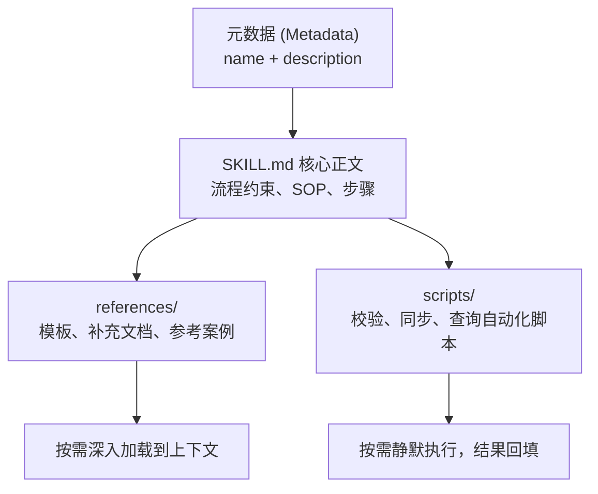
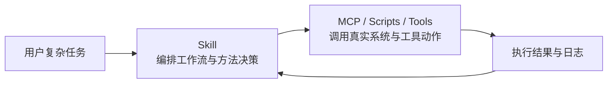

> **转载说明**  
> **出处**：[U7's Blog](https://u7u7.top/posts/skill-literacy-dev-skill-workflow.html)  
> **作者**：U7  
> **原文链接**：[Skill扫盲：从提示词补丁到AI工作流，我如何用dev-skill把经验沉淀成能力系统](https://u7u7.top/posts/skill-literacy-dev-skill-workflow.html)  
> *声明：本文仅供个人技术学习与交流分享，版权归原作者所有。*

---

> **核心导读**  
> 这半年我越来越强烈地感觉到一件事：**AI Coding 真正的分水岭，已经不只是“模型够不够强”，而是“你有没有办法把合适的方法，在合适的时机交给它”。**  
> 很多人第一次接触 `Skill`，会觉得它只是另一种 Prompt 封装。但如果你真的在 `Claude Code`、`Codex`、`Cursor` 这类工具里持续做开发，就会发现 `Skill` 解决的是**上下文按需加载、工作流阶段切换、团队经验沉淀以及从分析到审查的工程闭环**。  
> 本文结合真实开发仓库 `dev-skill` 与内部分享，从原理到工程实践全面讲透 Skill 体系。

---

## 一、为什么会有 Skill？

如果你经历过 AI Coding 从早期到现在的演进，会发现大家一直在解决同一个问题：

> **怎么把合适的信息，在合适的时机，放进模型的上下文里。**

一开始最常见的做法，是写全局 `Rules`：
* 这个仓库的业务背景是什么；
* 编码规范与命名风格是什么；
* 哪些坑不能踩；
* 哪些核心目录不能乱改。

这些东西一开始很有用，因为它能明显减少模型幻觉。但随着工程复杂度上升，问题迅速暴露：
1. **规则膨胀**：`Rules` 越写越长，动辄数千 Token；
2. **场景无关性**：很多规则只在特定任务下相关，却在每一次简单对话里都被全量加载；
3. **上下文注意力稀释**：Token 消耗成倍飙升，模型的长程注意力被海量无关规则分散。

在真实项目里，你很容易遇到这种割裂情况：
* 查日志时不需要前端开发规范；
* 画架构图时不需要数据库排障步骤；
* 写 API 文档时不需要完整的业务红线；
* 只做链路分析时，不应该每次都把 2000 token 的开发 rules 强行带上。

这就是 **`Skill`** 应运而生的核心背景。

### Skill 的第一性价值

如果把它压成一句话，定义就是：

> **`Skill` 的本质，是把原来“总是加载”的静态上下文，改造成“按需加载”的动态上下文。**

Skill 不仅是增加了一种文件格式，而是从根本上重塑了上下文管理范式：
* **先暴露极少量的索引信息**（Index / Catalog）；
* **让 Agent 自主判断是否相关**；
* **真正命中需要时，再加载完整操作流程**（SOP）；
* **更深层的资料、案例和自动化脚本，进一步延后到执行时按需调用或直接运行**。

这就是它最核心的底层思想——**渐进式披露（Progressive Disclosure）**。

---

## 二、什么是 Skill？

通俗讲，`Skill` 可以理解为：

> **一份带名字、带描述、带操作说明、还能挂载资源与自动化脚本的可执行能力模块。**

它通常至少包含两层结构：
1. **元数据（Metadata）**：`name`、`description`（供 Agent 快速检索与意图识别）；
2. **正文（Instructions）**：`SKILL.md` 里的工作流、约束、执行步骤、触发时机。

更为完备的企业级 Skill，还会附带：
* `references/`：参考模板、业务术语表、历史最佳实践；
* `scripts/`：轻量脚本、语法校验器、数据同步工具（可被 Agent 执行而无需通篇读入上下文）；
* `assets/`：图表模板、配置骨架等静态资源。

所以，Skill 不仅仅是“教 AI 怎么说”，更是：**给 AI 一份“这类任务应该怎么做”的可执行标准化操作手册。**

---

## 三、Skill 的核心原理：渐进式披露

你可以把渐进式披露想象成翻阅一本厚重的技术手册：
* **平时只翻目录**；
* **需要时才看章节**；
* **具体落地时，再去查附录工具**。

在成熟的 Skill 体系中，通常分为清晰的三层结构：

### 1. 第一层：目录层（Discovery）
* **组成**：仅包含 `name` + `description`；
* **特点**：始终常驻在 Agent 初始感知域中，极短，仅占用几十 Token；
* **作用**：告诉 Agent“当前环境拥有哪些能力可供调度”。

### 2. 第二层：章节层（Workflow）
* **组成**：`SKILL.md` 正文；
* **特点**：只有当 Agent 判断当前意图与该 Skill 匹配时才被激活读入；
* **作用**：规定具体 SOP 与质量红线（例如：先检查上下文 ➔ 提出澄清问题 ➔ 产出方案 ➔ 拆分 Task ➔ 最后编写代码）。

### 3. 第三层：附录层（Execution）
* **组成**：`references/` 补充文档与 `scripts/` 自动化工具；
* **特点**：延迟加载。脚本甚至可以直接在沙箱中静默执行并返回结果，其实现代码细节完全不必挤占模型的上下文窗口。

### Skill 三层架构推导图



**工程收益总结**：
* 极低 Token 底噪；
* 阶段性精准引导；
* 复杂资料不污染全局记忆；
* 脚本与工具解耦，提升系统确定性。

---

## 四、Skill 和 Rules、Commands、MCP 的分工

这是开发者最容易混淆的一组概念。在现代 Agent 架构中，它们各自承担着不可替代的职责：

| 机制 | 职责定位 | 典型内容 | 解决的核心痛点 |
| :--- | :--- | :--- | :--- |
| **Rules** | 静态长期背景 | 仓库总原则、编码红线、团队规范 | 提供全局不可逾越的底线，但会持续消耗 Token |
| **Commands** | 快捷操作入口 | `/openspec-proposal`、`/review` | 解决频繁手工输入长指令的问题，偏静态调用 |
| **MCP** | 物理系统与工具接入 | 调数据库、查日志、调外部 API、操作 Git | 赋予 Agent 真实的读写系统权限与数据通路 |
| **Skill** | 流程编排与方法论 | 需求澄清 SOP、重构流水线、测试闭环 | **决定什么时候该做什么、按什么步骤做** |

### 一句话核心区分
* **`Rules` 负责长期背景**；
* **`Commands` 负责快捷入口**；
* **`MCP` 负责工具能力**；
* **`Skill` 负责方法编排**。

### Skill 与 MCP 的协同闭环
很多人以为 Skill 和 MCP 是非此即彼的替代关系，其实不然：

> **MCP 把 Agent 连接到数据和系统（能做什么）；Skill 教会 Agent 如何处理这些数据、何时调用这些系统（怎么做好）。**



---

## 五、Skill 在真实研发流程中能做什么？

如果仅仅将 Skill 当成“写写周报的提示词模板”，就大大低估了它的潜力。在研发团队中，Skill 可以全面覆盖以下高频链路：

### 1. 需求澄清与方案设计（`brainstorming`）
* 严禁模型一上来盲目写代码；
* 强制执行：`深入分析上下文 ➔ 单点针对性提问 ➔ 多方案权衡对比 ➔ 确认后产出架构文档`。

### 2. 规范化开发流程编排（`sdd-dev-workflow`）
* 把 Spec-Driven Development（规范驱动开发）固化为流水线；
* 自动完成：技术方案拆解 ➔ 提取 Capability ➔ 创建 OpenSpec 提案 ➔ 人工确认 ➔ 拆解 Task 逐步实施。

### 3. 代码质量与综合评审（`full-review`）
* 将单个 CR 动作升级为自动化组合技能：
  * **影响面分析**（下游依赖与兼容性）；
  * **代码质量与坏味道审查**；
  * **自动化单元测试与集成测试用例推荐**。

### 4. 复杂业务排障与系统查询（`zan-dev-flow`）
* 提供统一的故障诊断路由，根据错误日志特征自动下发给日志查询、Redis 缓存探测、MySQL 慢查或 RPC 诊断等原子能力，化身“半自动排障助手”。

### 5. 跨系统文档与资产流转（`feishu-wiki-skill`）
* 读写知识库、自动解析设计图、将生成的 Markdown 实时排版并上传飞书，兼具文档与图片分析能力。

### 6. 多角色 Agent 团队协同（`vibe-working-agent-team`）
* 组织虚拟角色分工（架构师、开发、测试），配合终端分屏（tmux）与会话通信，推进从 PRD 到 CR 的完整工程落地。

---

## 六、dev-skill 仓库体系化演进经验

在个人的 `dev-skill` 生产实践中，有四个关键设计原则支撑其演化为团队的基础设施：

1. **确立单一事实来源（Source of Truth）**  
   仓库作为纯技能源码库，所有日常演进在此迭代。团队成员通过标准 Profile 安装或脚本同步，避免不同成员各自为战导致技能碎片化。

2. **按研发域分层组织**  
   * `skills/dev/`：编码与架构设计
   * `skills/cr/`：审查与测试验证
   * `skills/writing/`：文档与图表生成
   * `skills/zan/`：系统运维与内部排障
   * `skills/platform/`：安装分发与统计治理

3. **跨 IDE / Agent 框架无缝同步**  
   通过自动化同步脚本，一份标准的 Skill 定义可以一键映射部署到：
   * `~/.cursor/skills`
   * `~/.claude/skills`
   * `~/.codex/skills`
   * `~/.openclaw/skills`  
   彻底消除为每个 AI 工具重复编写适配规则的高昂维护成本。

4. **从“单点技能”走向“生命周期治理”**  
   建立专门的治理类 Skill：
   * `skill-usage-tracker`：统计调用频次与高频场景；
   * `skill-creator`：标准化新建与测试；
   * `knowledge-distiller`：从日常踩坑复盘中自动提炼新 Skill。

---

## 七、关键机制设计

想要写出生产级可靠的 Skill，需要重点把握以下五项机制：

1. **触发机制（主动调用 vs 意图自发现）**  
   编写极度准确的 `name` 与意图匹配词（`description`），让 Agent 能在复杂对话中精准嗅探到当前应加载的最佳流程。
2. **渐进式加载（严格控制 Token 开销）**  
   严格遵守“目录 ➔ 正文 ➔ 附录”三层法则，正文只保留核心推导 SOP，大段说明必须外置。
3. **依赖编排与拓扑路由**  
   支持大 Skill 组合多个小 Skill（例如综合路由 Skill 将请求分派至结对编程或严格规范流水线）。
4. **资源与脚本外置**  
   让 Python/Bash 脚本去做确定性高的事情（如查日志、跑校验），只将最终精炼数据输入给大模型。
5. **观测与指标回流**  
   监控哪些 Skill 真正产生价值，淘汰无人问津的冗余规则，持续打磨高频核心 Skill。

---

## 八、打造团队 Skill 系统的务实路径

如果你也计划在团队中推进落地 Skill 体系，建议遵循由简入繁的四步法则：

```text
第 1 步：锚定高频固定任务（需求澄清、技术方案写作、代码审查、日志排障）
   ↓
第 2 步：仅用标准 Markdown 明确流程、边界与输入输出（不要急于编写复杂脚本）
   ↓
第 3 步：逐步补齐 references/ 与 scripts/，将自动化工具与 MCP 接入流程
   ↓
第 4 步：建设版本发布、同步分发与使用统计，步入基础设施化治理
```

---

## 九、总结

过去很多人使用大模型，只是在和一个聪明的聊天机器人随机对话；  
但当你开始把**规则（Rules）、方法（Skill）、工具（MCP/CLI）、资源与治理体系**有机结合在一起时，AI 才会真正升级为高效协同的现代研发执行系统。

**`Skill` 的长远复利，就在于能够把优秀工程师做过十次、踩过十次坑的宝贵经验，沉淀为系统第十一次可以直接复用的确定性能力。**
