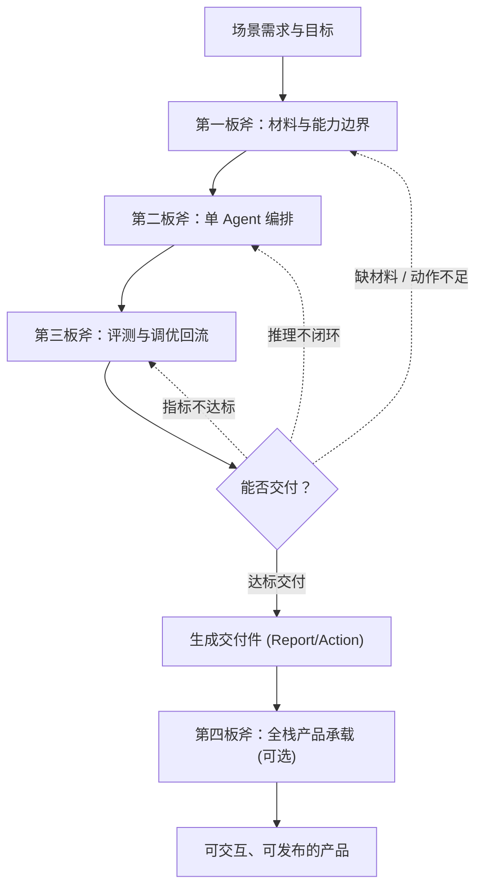
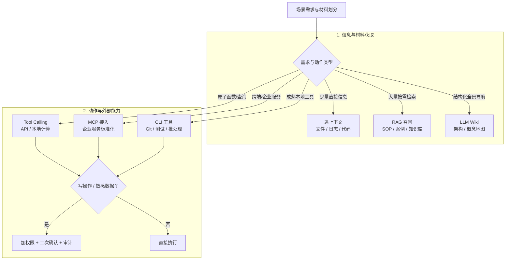
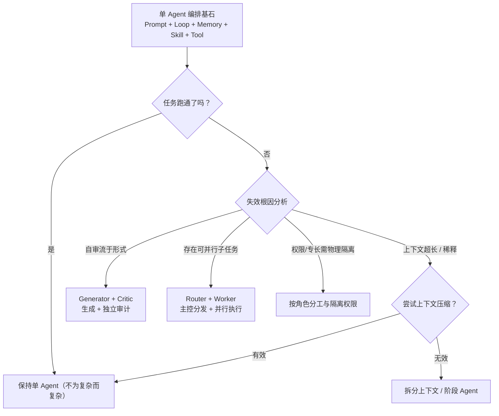
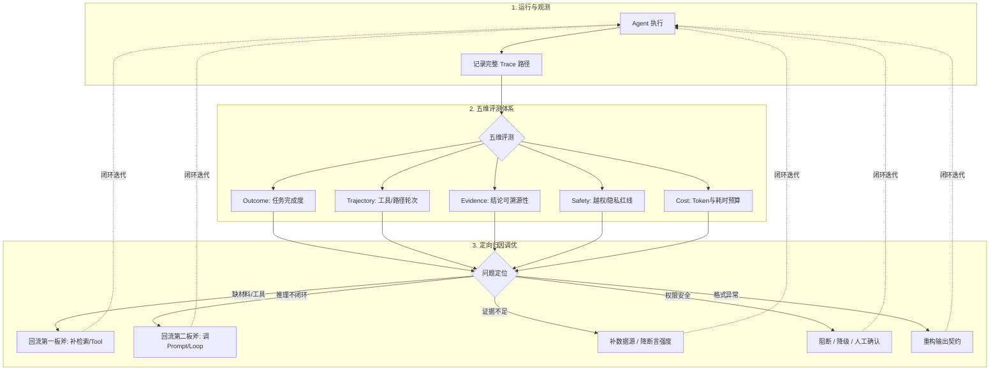
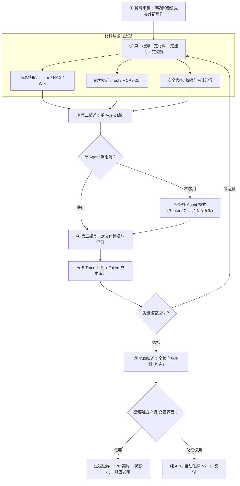

> **一句话原则**  
> 设计 Agent 的正确起点不是“选模型”或“选框架”，而是**从场景本身出发**：先拆清场景中有哪些信息、动作、判断和风险需要被系统化处理，再按四个连续问题推进。  
> **先拆场景，再定材料；先定材料，再编排能力；先定义可交付标准，再让评测结论回流；需要交互与发布时，再定承载方式。**

---

## 核心框架：四板斧

四板斧不是一张僵化的固定架构图，而是面对不同业务场景时的**设计推导顺序**。

| 板斧 | 核心问题 | 核心产出 | 深度详解专文 |
| :--- | :--- | :--- | :--- |
| **第一板斧** | 场景材料与外部能力设计 | 需要哪些材料和外部能力？ | [第一板斧：场景材料与外部能力设计](/2026/10/23/agent-design-materials-and-capabilities/) |
| **第二板斧** | Agent 能力编排与推理融合 | 如何编排 Agent 能力完成推理闭环？ | [第二板斧：能力编排与推理融合](/2026/10/23/agent-orchestration-and-reasoning/) |
| **第三板斧** | Agent 评测与调优 | 如何评测质量并把失败定向回流？ | [第三板斧：评测与调优](/2026/10/23/agent-evaluation-and-tuning/) |
| **第四板斧** | 全栈产品承载 | 如何装进可交互、可持久化、可发布的产品？ | [第四板斧：TypeScript 与 Electron 全栈产品承载](/2026/10/23/typescript-electron-fullstack-agent-product/) |

### 四板斧整体推导流程

---

## 第一板斧：场景材料与外部能力设计

Agent 不是凭空完成任务，必须先获得材料。本板斧解决**“材料从哪来、动作怎么走、边界在哪”**。

### 1. 材料来源梳理
* **本地材料**：文件、代码、日志、上传文档
* **企业系统**：API、数据库、工单、日历、IM 消息
* **外部资源**：搜索引擎、网页、知识库、历史文档
* **动态检索结果**：RAG、LLM Wiki、工具执行反馈

### 2. 关键设计判断矩阵

| 设计判断 | 典型选择 | 适用场景 |
| :--- | :--- | :--- |
| **什么进上下文** | 文件、日志、代码、用户输入、当前任务状态 | 少量关键高频信息，直接可用 |
| **什么走 RAG 召回** | SOP、历史案例、海量知识库、长文档 | 大量知识，需按 Query 动态语义命中 |
| **什么做成 Tool Calling** | 结构化函数、API、高精度数值计算、实时查询 | 原子级确定性动作，本地直接执行 |
| **什么用 MCP 接入** | 企业内部系统、远程服务、跨客户端复用能力 | 标准化协议解耦，跨平台统一治理 |
| **什么走 CLI** | 本地代码搜索、单元测试、Git、构建编译、批处理 | 成熟稳定的本地开发工具链 |
| **哪些必须加权限/审计** | 写操作、删除、外发、生产环境变更、敏感数据 | 高危动作，必须人工确认与阻断兜底 |

> **关键认知**：MCP、CLI、RAG、Tool Calling 都不是 Agent 本身，而是 Agent 获取材料和执行动作的入口。

### 3. 材料与能力决策树

---

## 第二板斧：Agent 能力编排与推理融合

有了材料不等于 Agent 会做事。**黄金法则：先用单 Agent 跑通任务，跑不通的原因往往就是该上多 Agent 的信号。**

### 1. 基石层：单 Agent 编排五大支柱

| 核心模块 | 解决的核心问题 | 设计边界与原则 |
| :--- | :--- | :--- |
| **Prompt** | 当前任务怎么做、输出长什么样 | 专注当前步骤，不承载冗长全量流程 |
| **Agent Loop** | 如何在工具反馈中持续推进任务 | 必须有显式停止条件与错误恢复状态机 |
| **Memory** | 如何管理长程状态、历史与经验 | 结构化事实沉淀，不等同于无脑全量聊天记录 |
| **Skill** | 这类任务以后怎么稳定复用 | 沉淀为标准操作手册 (SOP)，不等同于单次工具 |
| **Tool** | 执行具体原子动作 | 专注单一职责，不承载完整业务流程 |

### 2. 多 Agent 层：何时与如何升级？

| 单 Agent 失效信号 | 推荐设计模式 | 架构解析 |
| :--- | :--- | :--- |
| **上下文太长、注意力稀释** | 先试上下文压缩，不行再拆 | 避免盲目加模型，优先压缩治理 |
| **生成者自审流于形式** | **Generator + Critic** | 生成者提出假设，独立审计者校验驳回 |
| **任务存在天然可并行子任务** | **Router + Worker** | 主控负责任务拓扑拆解，Worker 并行推进 |
| **不同子任务需要不同物理权限** | **按角色隔离权限** | 研发角色只读，发布角色加签执行 |
| **需跨领域专长协作** | **专长分工** | 检索专员 + 深度推理员 + 结论校对员 |
| *简单工具调用、单轮问答* | **禁止上多 Agent** | 避免为复杂而复杂引入通信延迟与额外开销 |

> **认知升华**：多 Agent 的核心价值不是“多个模型一起胡思乱想”，而是**角色、上下文窗口、工具权限与责任边界的严格物理拆分**。

### 3. 单 Agent → 多 Agent 升级决策流程

---

## 第三板斧：Agent 评测与调优

Agent 的输出不能天然等价于最终交付件。本板斧回答两个连续问题：**怎么知道它好不好（评测），不好时怎么改（调优回流）**。

### 1. 评测的五个维度与调优闭环

> 普通 LLM 评测可以只看输入输出，但 **Agent 评测必须看完整 Trace**（执行轨迹）。  
> 核心实践：Golden Cases、三类评分器、基线管理、$pass^k$ 稳定性度量、CI 回归门禁。

### 2. 调优回流矩阵：问题精确回到对应环节

| 评测发现的问题 | 回流归因方向 | 落地修复动作 |
| :--- | :--- | :--- |
| **缺材料** | 第一板斧·场景材料 | 补全数据源读取、优化检索召回策略、扩充 Tool |
| **推理不闭合** | 第二板斧·能力编排 | 重组推理链、优化 Prompt 思维链、调整 Skill |
| **证据不足 / 幻觉** | 第一板斧 + 第二板斧 | 强化来源追溯、补充 Groundedness 约束、降低断言强度 |
| **权限与安全风险** | 第一板斧·安全边界 | 配置执行策略阻断、强制二次人工确认、沙箱隔离 |
| **格式与质量不达标** | 输出契约定义 | 重新约定 JSON Schema、结构化报告规范 |

### 3. Token 预算与成本审计
* **技术手段**（压缩、字段裁剪、Prompt Caching、上下文隔离）归属第二板斧的 Memory/Loop 模块；
* **预算基线设定、成本可观测性、成本审计看板、CI 回归防劣化**归属第三板斧治理机制；
* **核心权衡**：不是“越省越好”，而是**在证据链完整性与成本预算之间取得最佳工程平衡**。

---

## 第四板斧：全栈产品承载

前三板斧完成后，手中拥有的是一个高可用、可自愈的 Agent Runtime，但它仍只是一个“黑盒逻辑库”。**用户最终交互的是产品，而不是裸 Runtime。**

本板斧解决：**如何把 Agent Runtime 包装成可交互、可持久化、可调试、可打包、可发布的全栈工程应用？**

### 核心系统设计点
1. **进程边界清晰化**：
   $$\text{Renderer (UI)} \longleftrightarrow \text{IPC (协议契约)} \longleftrightarrow \text{Main (宿主控制)} \longleftrightarrow \text{Runtime (Agent 执行)}$$
2. **IPC 类型强契约**：使用 JSON-RPC 或类型化事件流，确保前端状态机与后端 Runtime 事件严格对齐。
3. **本地持久化机制**：Thread、Turn、Item 事实日志可落盘，随时支持任务中断、恢复与分叉。
4. **完备的产品生命周期状态**：
   * `Loading`（资源预热与推理中）
   * `Empty`（空态指引）
   * `Partial`（流式增量生成）
   * `Stale`（缓存过期提示）
   * `Error & Retry`（可恢复重试通道）
5. **打包与发布门禁**：集成 Release Gate，模型变更与 Prompt 更新必须通过离线回归测试后方可发版。

> *注：纯后台定时批处理脚本、单次 CLI 工具或轻量 API 探索可安全跳过本板斧。*

---

## 16 个核心模块全景速查表

| 核心模块 | 归属板斧 | 何时使用 | 何时不该使用 |
| :--- | :---: | :--- | :--- |
| **RAG** | 一 | SOP、排障案例、长文档需要动态提供引用依据 | 关键信息已在上下文、需要毫秒级精确查询 |
| **LLM Wiki** | 一 | 项目全局文档、架构说明、概念地图浏览 | 开放性动态问答（应优先用 RAG） |
| **Tool Calling** | 一 | 确定性函数、系统 API、精准计算与单点查询 | 涉及跨客户端通用治理与权限隔离（用 MCP） |
| **MCP** | 一 | 企业统一基础设施、远程微服务、跨客户端复用 | 单机本地已成熟的开发工具链（用 CLI） |
| **CLI** | 一 | 本地代码搜索、单元测试运行、Git、构建打包 | 需要跨网络标准化接入的远程能力（用 MCP） |
| **权限与安全** | 一 | 任何涉及写操作、远程调用、删除与敏感数据 | 纯只读且完全无敏感数据的封闭沙盒环境 |
| **Prompt** | 二 | 任务单步边界、目标格式、工具调用规范声明 | 承载超长跨轮业务流程与全量知识库（用 Skill/Memory） |
| **Agent Loop** | 二 | 任务需要“观察—行动—反思”的多步闭环推进 | 单轮即问即答、确定性一次性文本生成 |
| **Memory** | 二 | 需跨会话/跨轮次保留用户偏好、重要事实与结论 | 无脑将全量历史聊天记录堆叠进上下文 |
| **Skill** | 二 | 业务流程已形成可复用的标准化作业规范 (SOP) | 单个原子动作（用 Tool）或高度随机的临场任务 |
| **Multi-Agent** | 二 | 任务可物理拆解并行、需独立审计、需权限物理隔离 | 简单任务、职责边界模糊、为复杂而复杂 |
| **Eval 评测** | 二→三 | 任何需要进入生产环境交付的严肃 Agent | 纯实验探索性 Demo |
| **Trace 追踪** | 三 | 复杂任务复盘、长程故障定位、基线回归测试 | 一次性、无需复现的简单脚本调用 |
| **审计 Agent** | 三 | 生成者无法自我证明合格、高危决策双人复核 | 任务逻辑极简单、低风险的日常操作 |
| **Token 预算** | 三 | 任何计费或上线的企业级商业产品 | 纯本地运行小模型、不关心成本的本地实验 |
| **全栈产品承载** | 四 | 需要窗口交互、持久化会话、可分发安装包的产品 | 纯后台 API 服务、定时流水线脚本 |

---

## 新场景落地推导全流程

按四板斧顺序推进，每一步都问一句**“够不够用”**——够用就采用最简方案，不够才引入复杂度：

---

## 设计取舍核心原则

1. **没有外部材料需求，不强行上 RAG**；
2. **没有复杂分工与物理隔离需要，不强行上多 Agent**；
3. **流程已稳定重复，不每次依赖模型临场随机发挥**，应尽早沉淀为 Skill 或 Workflow；
4. **输出如果无法被客观评测与量化，就很难被称为真正可靠的工业级 Agent 交付**。
