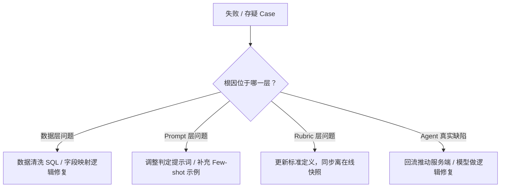

> **转载说明**  
> **出处**：微信公众号 **「大淘宝技术」**（2026年10月12日推文）  
> **作者**：淘天集团-交易数据技术团队 盈衣  
> **原文链接**：[淘宝AI购物助手在线评测落地实践](https://mp.weixin.qq.com/s?__biz=MzAxNDEwNjk5OQ==&mid=2650546388&idx=1&sn=9ccd19e3c6a8ee97a5ec6a963d2eb105&chksm=824b20e6757f7d71f93938fc9b1a50ff27aaef8c1c6ddbd662508feb9db9520d5c386361064c&mpshare=1&scene=24&srcid=1015lVkJ9qPUaLrM9ve527G1&sharer_shareinfo=cf1331d3fb12387cd601c435563561ed&sharer_shareinfo_first=cf1331d3fb12387cd601c435563561ed#rd)  
> *声明：本文仅供个人技术学习与交流分享，版权归原作者及大淘宝技术团队所有。*

---

> **核心导读**  
> **LLM-as-a-Judge** 的学术验证已较充分，但在日均百万条会话、多域异构的线上 Agent 场景中全量落地，公开讨论还很少。  
> 本文以电商购物助手购后各子域为对象，完整记录了如何让 LLM-as-a-Judge 做到日级工业化运行：从线上脏数据的四层清洗、分布式推理架构、CNT 六层漏斗 Rubric 框架、Prompt 幻觉压制与跨轮隔离，到评测归因驱动业务优化的闭环。  
> 实践表明，**评测可信度的瓶颈不在 Judge 模型本身，而在数据质量和评测标准的持续校准**。经过多轮打标迭代，各域评测通过率收敛到较高且稳定的水平，评测归因已能区分数据层、Prompt 层、Rubric 层和 Agent 真实质量问题，进而驱动定点修复验证。

---

## 一、业务背景与问题定义

### 1.1 购物助手回复效果难评估，技术链路优化方向缺依据

购物助手是电商平台的 AI Agent 产品，用户通过自然语言对话，完成问参数、查物流、办退款等购物服务。业务侧目前分为**购前**和**购后**两大场景，本次重点场景是购后，覆盖用户下单后的全链路服务，涉及多个业务域，每天处理大量用户 query。

每条 query 从用户发出到拿到回复，中间经过：

$$\text{路由决策} \longrightarrow \text{Skill 执行} \longrightarrow \text{工具调用} \longrightarrow \text{回复生成}$$

链路涉及主框架、意图识别模型、工具接口、卡片渲染等多个上下游系统。任何一个环节出问题，用户拿到的回复就可能不对。

* **离线评测的局限**：由测试团队在标准化用例平台上维护用例集，发版前做回归，设计为上线门禁。它测的是构造好的数据（query 精心设计、工具返回完整可控）。线上完全不同：用户表达模糊甚至带情绪，工具返回可能缺失或异常，数据分布持续漂移，因此离线通过率达标不等同于线上体验完善。
* **AB 实验的局限**：看转化率、留存这些业务指标，粒度太粗。即便转化率小幅下跌，我们也没法知道是某个域的路由出了问题还是某个域回复编造了信息，也就没法指导业务技术该优先优化哪个环节。

结果就是：**回复效果没有持续的量化观测，出了问题靠人工捞 case 排查，技术链路的优化方向缺少数据支撑**。

### 1.2 定义执行成功率，用日级自动评测替代人工抽检

为了看清复杂链路的细节，我们定义了**执行成功率**：对每条线上 query，判定它是否被正确路由到对应 skill，并且被合理回应。

它是一个三层漏斗的复合指标：

$$\text{执行成功率} = \text{路由准确率} \times \text{回复正确率}$$

前两层分别看路由和回复，执行成功率是端到端的综合判定，任何一层出问题都会拉低这个数字。

* **评测方式**：基于多轮会话的 **LLM-as-a-Judge**。对每轮对话，自动判定用户诉求是否被有效推进。
* **判定口径**：按业务场景拆分，不同域各有侧重（如时效准确性、流程合规、知识准确性），不存在用一套通用标准评估所有场景。
* **核心目标**：把 Agent 质量观测从月度/季度人工抽检变成**日级自动观测**，形成“对话采集 → 任务判定 → 指标量化 → 口径迭代”的正循环。有了这个数据底层，技术团队就能看到哪个域通过率低、低在哪一环节（路由/工具调用/回复内容），从而为优化方向提供依据。

### 1.3 LLM-as-a-Judge 的学术验证较多，但全量落地的工业实践少

LLM-as-a-Judge 的方法论近两年已经历系统性的学术验证：
1. **基石研究**：Zheng et al. 的 MT-Bench 和 Chatbot Arena 是该方向的奠基工作，证明 GPT-4 做 Judge 与人类偏好一致性超过 80%，同时揭示了位置偏差、冗长偏差和自我增强偏差。
2. **评测质量优化**：AlpacaEval 的 length-controlled 版本用回归控制长度偏差，将与人类排名的相关性从 0.94 提升到 0.98；Arena-Hard 从众包数据中自动筛选高难度 prompt，以 500 道题达到 MT-Bench 三倍的区分度。
3. **Judge 模型训练**：JudgeLM 证明 SFT 可将 GPT-4 的判定能力蒸馏到 7B 模型，一致性超过 90%，推理成本降低一到两个数量级。
4. **工业侧落地尝试**：美团技术团队在 Agent 分层评测方案中做了分层设计（系统级 → 任务级 → 轮次级），强调将模糊指标拆解为二元化规则来对齐评判标准。

**但这些工作有共同特点**：学术侧在受控环境评测，数据预先构造，不存在线上脏数据和分布漂移；工业侧多在千条级别验证。对日均海量会话、多域异构的场景，如何让 LLM-as-a-Judge 日级全量运行，公开讨论还很少。

我们面对的现实是：**全量推理成本不可接受，不全量又保证不了覆盖率**。下文将完整剖析如何在保住可信度的前提下，让 LLM-as-a-Judge 做到工业化可持续运行。

---

## 二、整体方案设计

整体方案分为五个阶段：**数据采集 → 数据清洗 → LLM 推理 → 结果解析与聚合 → 人工校验闭环**。端到端 pipeline 架构和团队协作关系如下图所示：

### 架构关键说明

1. **数仓与推理平台解耦**：数据层和结果层用数仓 SQL 实现，推理层用推理平台 workflow，两端解耦。因此改 Prompt 不需要改数据逻辑，改过滤规则不需要重跑推理。各域各自独立 workflow，数据量级从数千到数万条/天不等，推理耗时均在数小时级别。
2. **持续收敛的闭环迭代**：评测不是一次性交付，而是持续收敛的过程。每轮迭代走「抽样打标 → Judge-Human 一致性校验 → 归因分析 → 优化 Prompt/Rubric → 发车评测 → 重抽样」的闭环。数科负责“怎么评”（pipeline 工程、Prompt 设计、指标计算），测试和产品定义“评什么”（评测标准、Rubric 严格程度），两端通过打标闭环持续对齐。

---

## 三、关键问题与解法

### 3.1 数据清洗与加工：从“原始日志”到“Judge 可消费的输入”

#### 1. 面对的问题
LLM-as-a-Judge 的评测质量不只取决于模型和 Prompt，更取决于喂给 Judge 的数据质量。线上 Agent 的原始交互日志不是为评测设计的，直接用来做 Judge 会导致模型不稳定、一致率低。具体体现在：
* **数据源碎片化**：涉及用户 query、Agent 回复、工具调用链路、卡片渲染内容等多路信号，分散在不同的数仓表中，字段命名和格式各异。
* **评测数据缺失**：线上主框架日志没有落卡片的结构化内容，物流卡片、订单卡片等关键评测素材在线上评测时不可见；部分域的下单时间、商品标题、订单金额等信息也没有落到日志里。
* **`tool_calls` 中的噪声**：`tool_calls_json` 中包含工具接口的内部提示词（系统指令、开发注释等），这些不是 Agent 生成的内容，但会被 Judge 误读为 Agent 回复，导致评测偏判。
* **语义无法对齐**：同一概念在用户视角和系统视角下表达不同（如用户说“已揽收”但系统状态是某个英文枚举值，两者并不天然等同于“已发货”），Judge 如果不理解映射关系，就会基于字面意思做出错误判定。

#### 2. 我们的解法：四层清洗 Pipeline
我们建立了一套面向在线 Judge 场景的**四层数据清洗 pipeline**，逐层解决数据质量问题：

* **第一层：修复数据格式不一致**  
  离线数据格式规范、字段完整；线上数据来自真实用户会话日志，各 skill 卡片协议独立、字段解析方式各异。直接复用离线 Prompt 会导致线上数据大量解析为空。因此在线评测对标离线 Prompt 的数据定义，逐域修复解析逻辑、补全字段映射。例如某域卡片文本长达数千字，拼接后超长导致推理超时，需做合理截断。
* **第二层：语义对齐**  
  用户表达的订单状态与系统记录的状态存在语义差异。在 Prompt 中显式建立用户语义与系统语义的映射字典，避免 Judge 望文生义判为矛盾。
* **第三层：屏蔽干扰信号**  
  `tool_calls_json` 中包含工具接口内部的生产链路提示词。修复方式是用正则剔除工具接口中透传的系统提示词，只保留 Agent 实际调用工具的参数和返回值。这一步对所有域生效，屏蔽后各域评测准确率均有明显提升。
* **第四层：过滤规则精化**  
  早期各域的 query 入口过滤规则过于宽泛，大量不属于该 skill 的 query 被纳入评测。修复方式是在各域评测入口增加基于 skill 标识的精确过滤。过滤精化后各域评测数据才真正可信。

---

### 3.2 平台使用与工作流设计：分布式推理的工程实践

#### 1. 面对的问题
日级全量线上评测意味着每天要对海量会话逐条做 LLM 推理判定，这是一个典型的分布式批量推理工程问题：
* **规模与时效**：每天定时完成全量评测，输出当日指标。单域 workflow 运行数小时，多域并行需要在次日凌晨前全部完成。
* **多域异构**：各评测域 Prompt 模板、数据量级、推理耗时各不相同，无法一刀切。
* **稳定性要求**：任何一次中断都会导致当天指标缺失，需要完善的容错和重试机制。

#### 2. 我们的工程做法

1. **架构解耦：数仓与推理平台分工**  
   * **推理平台**：只负责 LLM 推理（拼接 Prompt → 调用模型 → 返回结构化结果）。
   * **数仓 SQL**：负责前期数据清洗、多源拼接、过滤规则，以及后期的结果解析、标签归一化、指标聚合。  
   * **收益**：推理平台保持轻量；预处理与后处理 SQL 可复用、可回溯；两端解耦后迭代效率大幅提高。
2. **数据完整性校验：Check 节点**  
   在推理完成后设置 check 节点：对比 input 表条数与推理 output 表条数，一致才进入下一步解析。这能有效防御推理超时丢数、历史分区叠加未覆写等导致的指标失真问题。
3. **工作流拆分：按域独立 Workflow**  
   摒弃“一个大 workflow 跑全域”的做法，避免短板效应拖慢、单域失败阻塞全局。采用各域独立 workflow，按域配置队列、并发度与重试策略。
4. **核心踩坑与解法**：
   * *资源竞争与排队*：错峰调度 + 关键业务域申请独占资源池。
   * *Prompt 超长丢失*：部分多轮对话超长后，平台静默返回空结果。在数据准备层增加 token 预检并做截断与摘要。
   * *数仓回刷叠加陷阱*：回刷历史分区前必须先清空目标分区，避免 append 模式导致数据翻倍。

---

### 3.3 模型选型：Judge 模型的选择策略

#### 1. 面对的问题
底座模型决定了评测质量上限与成本下限。Judge 任务本质是**基于 Rubric 的复杂分类与判定**，要求极高的指令遵循能力和逻辑推理能力，而非泛泛的生成与创作。

#### 2. 分阶段模型选型策略
* **第一阶段（当前采用）**：选择一款指令遵循能力与逻辑严密性顶级的大模型作为底座。
  * 匹配度高：在长上下文、多条件复合判定与结构化输出表现卓越。
  * 确立效果天花板：验证“优质 Prompt + 顶尖大模型”能够达到的准度上限，沉淀高质量打标数据。
* **第二阶段（规划演进）**：基于沉淀的人标与大模型一致样本构建 SFT 训练集，**蒸馏微调垂直领域的专门 Judge 小模型**，兼顾高准确率与低推理成本。
* **Temperature 调优**：最终固定为 **0.1**。既保证同一用例多次推理判定的极高确定性与可复现性，又保留微弱随机性防止模型僵死。

---

### 3.4 Rubric 设计：用户型产品的评测标准体系

#### 1. 统一框架：CNT 六层漏斗体系
如果评测标准不清晰，Judge 的结论绝不可能可信。我们重构了各域标准，建立了全局统一的 **CNT 六层漏斗框架**：

1. **CTX（上下文门控）**：判断样本是否具备评测所需证据。若证据不足，标记为 `N/A` 不计入通过率分母。**“诚实跳过”优于“强行乱猜”**。
2. **OOSR（越界拒答）**：当 query 不属于该 skill 承接范围时，Agent 是否正确拒答或转交上层。
3. **OOC（能力边界诚实）**：当 query 在 skill 范围内但超出当前系统能力时，Agent 是否诚实说明边界，而非胡乱编造。
4. **TCC（工具执行链路）**：是否调用了正确工具、参数是否匹配意图、链路是否自洽。
5. **CNT（内容与文本）**：Agent 回复的内容正确性、完整性与表达质量。最贴近用户感知，域间差异最大。
6. **RED（安全红线）**：内部信息外泄、隐私泄露、违规引导、编造政策等红线。**与串行层并联、恒定全量核查**。

> **短路串联机制**：前 5 层任一层判 0，后续串行层记 `N/A` 并整体判 0（短板原则）；但 RED 独立并联核查。这兼顾了“主因定位”与“安全底线”。

#### 2. 适配 C 端用户型产品的特异性设计
* **模式判定与诚实兜底放行**：同一个 query 在工具返回有数据（模式 A）和无数据（模式 B）时，Agent 的正确行为完全不同。模式 B 下“忠实兜底 + 引导查看详情”即为符合预期，不能因未提供具体数据而扣分。
* **意图码分流与硬退出**：二级意图驱动评测路径分流，正向场景命中即 CTX 退出判通过。
* **盲区兜底声明**：线上无法获取卡片内部结构化数据时，严禁 Judge 假设存在或强行判 0。
* **Rubric 代码化与版本化**：Rubric 文件以 Markdown 纳入 Git 版本控制，包含完整的 YAML 元数据与变更日志，离在线 Prompt 直接从中派生。

---

### 3.5 Prompt 设计：让 Judge 输出稳定可信

即使 Rubric 再完善，Prompt 的工程细节仍决定最终成败。我们沉淀了多项关键技术实践：

1. **变量显式声明与严格 JSON Schema**：在开头显式定义 `user_query`、`agent_reply`、`tool_calls` 等字段，指定输出 JSON 格式、枚举值与类型约束。
2. **压制模型幻觉的四项实践**：
   * **锚定事实来源**：显式禁止引入外部常识或未提及的假设。
   * **反向引用取证**：强制 Judge 在打分前先摘录 Agent 原文中的相关片段作为事实凭证。
   * **边界 Case 的 Few-shot 注入**：针对高频易混淆的边界 case 提供典型示例。
   * **禁止推断判定**：信息不足必须打标签“剔除”，严禁脑补打分。
3. **时间锚点拼接**：拼接用户提问的精确时间戳（如 `2026-10-12 10:59:00`），作为 Judge 评估“明天到达”、“近一年”等时间表述的基准，彻底消除时间敏感维度的批量误判。
4. **跨轮信息隔离（反直觉发现）**：
   * 在多轮对话中，我们原先给 Judge 输入完整的历史工具链。实践证明**上下文并非越多越好**！
   * LLM 在面对长多轮工具链时注意力容易分散，会误拿前轮工具数据判定当轮回复。
   * **改为只传递当前轮次的工具调用后，通过率显著跃升**。
5. **解析侧三层兜底**：Prompt 强约束 → 输出校验拦截器 → 数仓 SQL 标签归一化清洗。

---

### 3.6 多轮打标优化：逼近“真实线上水位”的迭代闭环

#### 1. 闭环迭代机制
评测数字的可信度必须通过多轮闭环逼近真实线上水位：

#### 2. 四层归因体系：存疑 Case 根因定点修复
当评测结果存疑时，失败必须追溯到四层之一，避免盲目修改 Prompt 掩盖真正问题：

* **数据层问题**：系统提示词未过滤、日志字段缺失、长卡片截断。修复清洗 SQL。
* **Prompt 层问题**：边界 case 规则模糊。补充示例或判定指引。
* **Rubric 层问题**：标准与业务认知存在分歧（如模式 B 兜底误判）。修改 Rubric 定义。
* **Agent 真实质量问题**：排除上述后，确实属于 Agent 产生幻觉、调错参数或触发红线。

---

## 四、评测归因：从“看水位”到“驱动优化”

### 4.1 评测的价值在于归因

执行成功率跑出来只是一个数字。如果评测只停留在报数，业务团队的第一反应必然是“那到底该改哪里”。评测的核心产出在于**归因**：
* **宏观归因**：基于 CNT 六层漏斗和子项码，明确失败聚集在哪一层、哪一类子项。
* **微观归因**：对具体问题构建可在 SQL 中复跑的正则检测规则，在修复前后的日期分区对比命中数。

### 4.2 指标异动归因案例：某域路由成功率骤跌

某天某域的路由通过率断崖式下跌，直觉以为是算法模型回归：
1. 拆解分子分母：发现匹配到该 skill 的 trace（分子）数日平稳，而分母在两天内翻了近三倍。
2. 溯源分析：全站总 query 平稳，暴涨完全集中在某个单项 label。这批 query 全是“功能异常怎么排查”等使用类咨询。
3. 根因确认：上游另一个 skill 放量后，意图模型误将此类咨询标成了该域的投诉 label，被该域 base 过滤条件抓进分母。
4. 修复生效：从评测过滤条件中剔除该非业务动作 label 后，通过率跌幅彻底抹平恢复正常。**避免了一次对算法链路的无效盲改**。

### 4.3 定点修复核验：通过评分理由字段判断问题收敛

针对某时效类域提炼的 5 类高频失败，开发团队修复后，通过评分理由的 SQL 正则检测比对修复前后的效果：

总失败样本大幅下降，5 类问题中 2 类显著修复、1 类大幅收敛、1 类部分好转。定点核验验证了闭环的可行性。

### 4.4 落地收益与当前边界

各子域评测指标均已沉淀为 BI 监控看板：

当前边界在于：归因已能精准定位根因，但问题修复仍需人工排期推进，评测坏样本尚未全自动回流到 Agent 的训练链路（SFT / GRPO）。

---

## 五、现存局限与未来规划

### 5.1 在线评测能力五级成熟度全景

在线评测体系沿五级成熟度（L1 能评 → L2 评得准 → L3 省又全 → L4 自动闭环 → L5 自运营）持续演进：

* **L1 能评（已完成）**：执行成功率三层漏斗、CNT 六层 Rubric 框架、代码化版本管理。
* **L2 评得准（进行中）**：CI 反推样本抽样、幻觉压制四项原则、时间锚点拼接、跨轮信息隔离、温度 0.1 调优已完成；已知三类偏差（位置/冗长/宽松）的系统治理待开展。
* **L3 省又全（部分完成）**：大模型天花板验证、错峰调度已跑通；SFT 微调小 Judge、Batch API、Prompt Caching 待上线。
* **L4 自动闭环（部分完成）**：Pipeline 自动化、四层归因、定点核验已建立；Release Gate 门禁与坏样本自动回流训练链路待打通。
* **L5 自运营（部分完成）**：BI 双视角看板已接入；Drift 漂移告警与智能推送待落地。

### 5.2 下一步重点突破方向

1. **降本（入场券）**：将大模型 SFT 蒸馏到特定小模型 Judge，结合科学采样与 Prompt 缓存大幅压缩 Token 开销。
2. **补精度地基（护城河）**：系统治理位置偏差（交换双评）、冗长偏差与宽松偏差；引入多 Judge 交叉裁决。
3. **接通后训练闭环（复利）**：打通坏样本向 SFT/GRPO 训练集的自动回流，构建“评测发现问题 → 强化学习训练 → 评测核验”的端到端飞轮。

---

## 团队介绍与拓展阅读

**关于作者与团队**：  
本文作者**盈衣**，来自**淘天集团-交易数据技术团队**。该团队致力于面向淘宝交易履约链路（详情、下单、支付、购物车、订单、物流、逆向、评价等）海量数据挖掘 DAU、DAC 及用户体验增长机会。同时持续探索 AI 数据智能、AI-Native 数据研发模式、AI Agent 产品分析、评测与训练方向，推动 Agent 产品策略优化与迭代飞轮。
