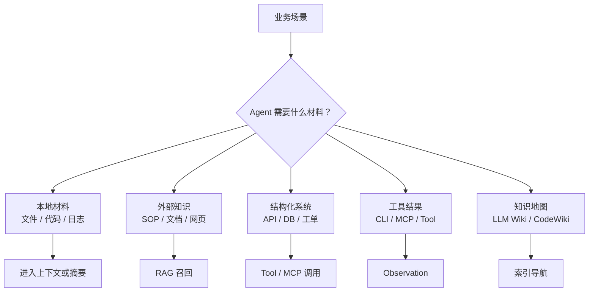
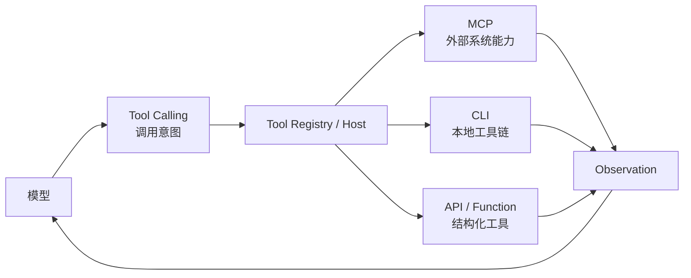
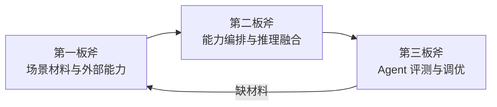

> **导航**：本文为《通用 Agent 设计方法论》系列第一篇。  
> 📖 系列总览：[通用 Agent 设计方法论（四板斧）](/2026/10/22/general-agent-design-methodology/)  
> ➡️ 下一篇：[Agent 能力编排与推理融合（第二板斧）](/2026/10/23/agent-orchestration-and-reasoning/)

---

> 🔍 **Folio 案例解析**  
> Folio 在第一板斧中用于说明 Financial Data Provider、Broker Account Provider、Capability、Tool、Data Provenance 和权限边界如何分工。阅读时只观察设计选择，不需要接入金融数据、创建 Tool 或复刻代码。

> 🎯 **一句话原则**  
> 设计 Agent 的第一步不是写 Prompt、选框架，而是判断场景需要哪些材料和外部能力——以及它们的边界在哪。

一个 Agent 能做什么，很大程度上取决于它能看到什么、能调用什么、能验证什么。模型内部知识只能提供通用背景，真正的业务任务通常依赖外部材料：文件、日志、代码、数据库、API、网页、工单、历史文档、知识库、工具执行结果。

> ❗ **核心边界**  
> 这一部分不是在设计 Agent 如何推理，而是在设计 Agent 的**“信息入口”**和**“动作入口”**。

---

## 一、场景材料的类型

场景材料大致可以分成几类：

| 材料类型 | 典型来源 | 对 Agent 的意义 | 常见风险 |
| :--- | :--- | :--- | :--- |
| **本地材料** | 文件、代码、日志、上传文档 | 提供任务的直接上下文 | 太长、噪声多、版本不一致 |
| **外部知识** | 文档库、历史案例、SOP、网页 | 提供领域知识和背景依据 | 召回错、过期、来源不明 |
| **结构化系统** | API、数据库、工单、指标平台 | 提供实时状态和业务事实 | 权限、行级数据、写操作风险 |
| **工具结果** | CLI、Tool Calling、MCP Tool | 提供可执行动作后的反馈 | 参数错、结果过大、危险命令 |
| **知识地图** | LLM Wiki、CodeWiki、DeepWiki 类资料 | 提供可索引、可追溯的项目知识结构 | 索引过粗、正文缺证据 |

材料设计的核心不是“越多越好”，而是判断**哪些信息对当前任务是必要证据，哪些只是噪声**。

---

## 二、RAG 与 LLM Wiki 的分工

### 1. 两者的核心关注点
* **RAG 解决的是“从大量资料里召回什么”**：
  - 文档怎么分块。
  - 用什么 embedding。
  - top-k 取多少。
  - 是否需要混合检索和重排序。
  - 召回失败和生成失败如何区分。
* **LLM Wiki 类思路解决的是“知识如何组织成 Agent 可理解的结构”**：
  - 项目知识如何分层。
  - 哪些内容是索引，哪些内容是正文。
  - 如何让模型从一个概念跳到对应依据。
  - 如何让长材料不是散落文本，而是可导航的知识地图。

### 2. 对比矩阵

| 对比项 | RAG | LLM Wiki 类知识组织 |
| :--- | :--- | :--- |
| **核心问题** | 从资料中取哪些片段 | 资料本身如何组织 |
| **典型对象** | SOP、FAQ、历史案例、长文档 | 项目文档、代码说明、概念地图 |
| **强项** | 动态召回相关内容 | 提供结构和导航 |
| **风险** | 召回错、片段缺上下文 | 索引漂亮但证据不足 |
| **与 Agent 的关系** | 给推理层提供片段 | 给推理层提供路径和背景结构 |

> **总结**：RAG 更像动态召回机制，LLM Wiki 更像知识组织形态。前者解决取片段，后者解决材料结构。

---

## 三、Tool Calling、MCP 与 CLI 的分工

* **Tool Calling 是模型表达调用意图的方式**。模型说“我要调用什么工具，用什么参数”，但真正执行、权限判断和结果处理都必须由模型外部系统完成。
* **MCP 是外部能力接入协议**。它更适合跨系统、跨客户端、需要标准化发现和治理的外部能力，例如企业知识库、工单系统、日历、IM、数据库、日志平台。
* **CLI 是本地执行接口**。它更适合成熟本地工具链，例如 `rg` 搜索、Git 操作、测试执行、文件处理、构建检查、批处理脚本。

### 三者选型对比

| 能力 | 回答的问题 | 适合场景 |
| :--- | :--- | :--- |
| **Tool Calling** | 模型如何表达“我要调用工具” | 函数、API、查询、计算 |
| **MCP** | 外部工具和资源如何被标准化接入 | 企业系统、远程服务、跨客户端复用 |
| **CLI** | 本地已有工具如何被高效执行 | 搜索、测试、构建、Git、批处理 |

> 它们不是替代关系，而是不同层面的能力入口。

---

## 四、外部能力必须带边界

外部能力越强，越不能直接交给模型自由使用。常见边界包括：
1. **只读和写操作分级**。
2. **高风险动作人工确认（HITL）**。
3. **路径、网络、数据库权限限制**。
4. **命令白名单和危险命令拦截**。
5. **工具输入输出日志与审计**。
6. **结果截断、摘要和外置化**。
7. **Prompt injection 防护**。

> 💡 **不要把模型当安全边界**  
> 模型可以生成工具调用意图，但授权、拦截、审计、确认必须在模型外部完成。权限设计不只是安全模块，它从材料和工具入口就必须存在。

---

## 五、这一部分如何连接后续设计

场景材料与外部能力设计的输出，不是最终答案，而是给后续 Agent 编排提供输入：

| 设计产物 | 进入下一环节的方式 |
| :--- | :--- |
| **哪些材料进上下文** | 影响 Prompt 和 Context 组织 |
| **哪些知识走 RAG** | 影响检索和引用依据 |
| **哪些能力做 Tool** | 影响 Tool Registry 和权限模型 |
| **哪些系统走 MCP** | 影响外部能力接入和治理 |
| **哪些动作走 CLI** | 影响本地执行和命令审计 |
| **哪些操作必须确认** | 影响质量审计与反馈闭环 |

如果这一部分设计不清，后面的 Prompt、Memory、Skill、Eval 都会建立在不稳定材料上。

---

## 六、模块边界与使用时机

| 模块 | 边界 | 何时用 | 何时不用 |
| :--- | :--- | :--- | :--- |
| **RAG** | 从资料中动态召回片段 | SOP/FAQ/历史案例/长文档需引用依据 | 信息已在上下文、或需实时精确查询（用 Tool/API） |
| **LLM Wiki / 知识地图** | 把资料组织成可导航结构 | 项目文档/代码说明/概念地图 | 动态问答场景（用 RAG） |
| **Tool Calling** | 模型表达调用意图 | 函数/API/查询/计算 | 需要跨客户端标准化治理（用 MCP） |
| **MCP** | 外部能力标准化接入 | 企业系统/远程服务/跨客户端复用 | 本地成熟工具链（用 CLI） |
| **CLI** | 本地工具链高效执行 | 搜索/测试/构建/Git/批处理 | 需要标准化发现与治理的远程能力（用 MCP） |
| **权限** | 工具和动作的边界控制 | 任何写操作/外部调用/敏感数据 | 纯只读且无敏感信息 |

---

## 七、承上启下

* **向前**：本板斧是整套方法论的起点——没有可靠材料，推理会幻觉，工具会空转，权限会失控。
* **向后输出**：哪些材料进上下文（影响 Prompt）、哪些走 RAG（影响检索与引用）、哪些做 Tool/MCP/CLI（影响工具注册与权限）、哪些必须确认（影响第三板斧审计）。
