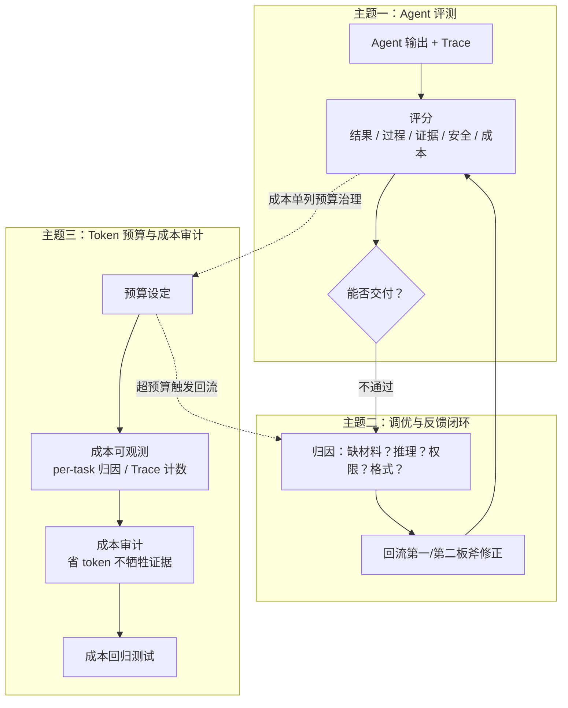
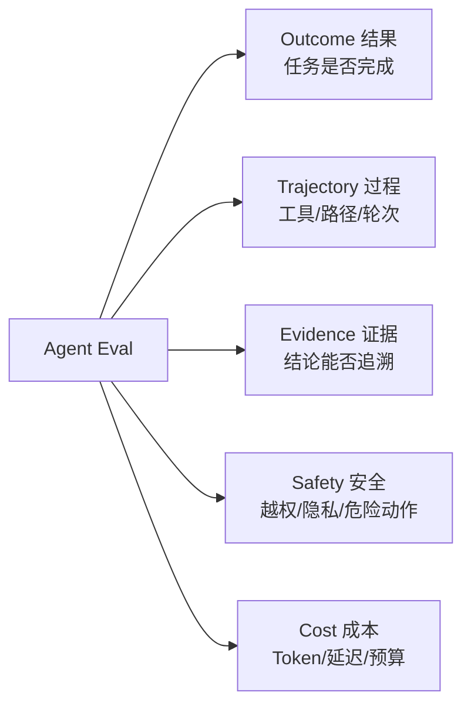
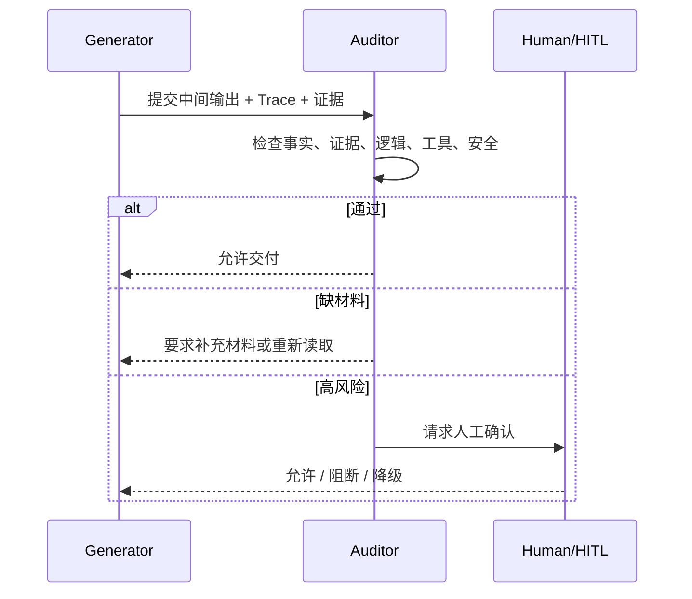
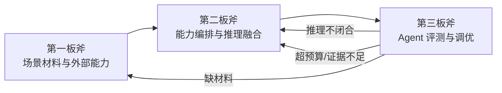

> **导航**：本文为《通用 Agent 设计方法论》系列第三篇。  
> ⬅️ 上一篇：[Agent 能力编排与推理融合（第二板斧）](/2026/10/23/agent-orchestration-and-reasoning/)  
> 📖 系列总览：[通用 Agent 设计方法论（四板斧）](/2026/10/22/general-agent-design-methodology/)  
> ➡️ 下一篇：[TypeScript 与 Electron 全栈产品承载（第四板斧）](/2026/10/23/typescript-electron-fullstack-agent-product/)

---

> 🔍 **Folio 案例解析**  
> Folio 在第三板斧中用于说明 Trace、Evidence、Outcome、Trajectory、Safety、Cost Eval、Partial Success、Recovery UX 和发布门禁如何共同表达“可信”。阅读时只观察评测与回流设计，不要求建立评测集或运行发布 Gate。

> 🎯 **一句话原则**  
> 先能判断好坏（评测），再让判断驱动改进（调优回流），由成本治理守住预算。**没有评测的 Agent 只有“感觉不错”，没有回流的评测只是打分记录。**

Agent 输出不是天然可信的最终答案。只要 Agent 能调用工具、读取外部资料、生成结论、修改环境，就必须先回答“怎么知道它好不好”，再回答“不好时改哪里”。

本板斧围绕三个核心主题展开：

> ❗ **核心边界**  
> 评测不是“润色回答”，而是判断这个结果能否作为交付物进入真实场景；调优不是“哪里不好改哪里”，而是按归因回流到对应的板斧；Token 审计不是“能省则省”，而是在证据完整性和成本之间找到平衡点。

---

## 主题一：Agent 评测体系

### 1.1 评测算什么：五类 Eval

普通 LLM 评测可以只看输入输出，但 Agent 评测必须看 **Trace**。因为 Agent 的质量不仅体现在最后一句话，更体现在它做了什么、怎么做、有没有绕过边界。

我们将评测统一抽象为五类 Eval：**Outcome（结果）**、**Trajectory（过程）**、**Evidence（证据）**、**Safety（安全）**、**Cost（成本）**。

* **Outcome（结果测评）**：看最终任务有没有真正完成；
* **Trajectory（过程测评）**：看工具调用、执行路径、轮次消耗和中间决策是否合理；
* **Evidence（证据测评）**：看输出结论能否严密追溯回到材料或工具结果；
* **Safety（安全测评）**：检查是否存在越权、隐私泄露、高危系统命令和 Prompt Injection 风险；
* **Cost（成本测评）**：检查 Token 消耗、工具调用次数、重试次数和端到端延迟是否超出预算。

---

### 1.2 评测的工程化落地

从“随手做几轮手工提问”到“建立一套可回归的工业级评测体系”，关键在于工程化：

| 工程化环节 | 回答的核心问题 |
| :--- | :--- |
| **Golden Cases 用例集** | 哪些真实业务任务必须永远通过？失败样例如何自动化沉淀为回归用例？ |
| **三类评分器** | 哪些结果用确定性代码断言（Rule-based）？哪些需要 LLM-as-a-judge？哪些必须专家人工复核？ |
| **基线管理** | 这一次 Prompt 或工具链改动到底变好了还是变差了？和哪个 Baseline 比较？ |
| **稳定性指标（$\text{pass}@k$）** | 同一个用例跑 $k$ 次都能稳定通过吗？还是碰巧通过？ |
| **Trace 工程化** | 过程证据能否完整复现、能否还原 Agent 每一步的操作依据？ |
| **CI/CD 回归** | 评测能不能在每次代码或 Prompt 提交后自动跑，而不是上线前靠运气？ |

---

### 1.3 详细检查维度表

评测检查的是整个 Agent 执行链路，而不仅仅是文本通顺度：

| 归属 | 详细维度 | 关注重点 | 常见失败信号 |
| :--- | :--- | :--- | :--- |
| **Outcome** | 用户要求满足度 | 是否回答了真实问题，是否遗漏核心约束 | 答非所问、无视负面约束 |
| **Evidence** | 事实可靠性 | 结论是否有事实依据，是否把推测写成断言 | 无来源、强断言、事实幻觉 |
| **Evidence** | 证据充分性 | 关键判断是否能回到材料、工具结果或 Trace | 结论与证据脱节断裂 |
| **Trajectory** | 逻辑闭合 | 从材料到结论是否存在跳步和自相矛盾 | 因果倒置、前后结论冲突 |
| **Trajectory** | 工具使用合理性 | 是否调用了最合适的工具，参数是否合理 | 没查就答、无脑重复调工具 |
| **Safety** | 安全与权限 | 是否越权、泄露、执行危险动作 | 未经确认执行写操作、暴露密钥 |
| **Outcome** | 交付格式 | 是否符合输出规范、数据结构契约 | 字段缺失、关键风险未标注 |

---

## 主题二：调优与反馈闭环

评测发现不合格之后，改进绝不能靠“换个温度再生成一次碰运气”。  
**调优 = 归因 $\rightarrow$ 回流 $\rightarrow$ 重跑同一用例验证**。

### 2.1 审计 Agent 的职责与交互

审计 Agent（Critic / Reviewer / Evaluator）不应该直接代行原任务，而是独立挑战生成者的输出：

> **核心价值**：审计角色的价值在于制造**独立视角**，避免生成者“既当运动员又当裁判员”。

---

### 2.2 不通过时的回流路径

审计不通过时，系统不应简单报错中断，而应精准将问题反馈至对应设计板斧：

| 审计暴露的问题 | 精准回流方向 | 核心修正动作 |
| :--- | :--- | :--- |
| **缺材料** | 第一板斧·场景材料与外部能力 | 补充读取、改进检索策略、增加必要工具调用 |
| **推理不闭合** | 第二板斧·能力编排与推理融合 | 重构推理链、优化 Prompt 约束、沉淀为 Skill |
| **证据不足** | 第一板斧 + 第二板斧 | 溯源补充证据、降低断言语气、明示不确定性 |
| **权限风险** | 第一板斧·权限与安全边界 | 拦截高危指令、降级为只读、触发人工审批流 |
| **格式不达标** | 输出契约定义 | 重新校验 Schema、调整输出格式与结构化约束 |

---

## 主题三：Token 预算与成本审计

### 3.1 为什么 Token 治理属于第三板斧？

节省 Token 的**技术手段**（上下文压缩、滑动窗口、裁剪、工具结果外置）散落在第二板斧的 Memory、Loop、Prompt 模块中——它们回答的是**“怎么省”**；  
但 Token 的**预算设定、成本可观测性、成本审计、成本回归测试**是治理问题——它们回答的是**“该不该花、花得对不对、有没有成本漂移”**，属于质量与可交付性范畴，因而归入第三板斧。

| 视角 | 归属环节 | 回答的核心问题 |
| :--- | :---: | :--- |
| **节省技术**（压缩/裁剪/缓存/隔离） | 第二板斧 | 怎么省 Token、怎么放上下文 |
| **预算与成本审计** | **第三板斧** | 该不该花、花得对不对、上线会不会亏本 |

---

### 3.2 成本审计与质量审计的平衡

省 Token 与保证证据完整性之间存在天然张力：
* **过度压缩上下文** $\rightarrow$ 证据丢失 $\rightarrow$ 事实可靠性下降；
* **过度裁剪工具结果** $\rightarrow$ 观察不充分 $\rightarrow$ 推理出现逻辑跳步；
* **过早终止 Loop** $\rightarrow$ 任务未充分求解 $\rightarrow$ 用户要求无法满足。

> 💡 **准则**  
> Token 审计的核心不是“越省越好”，而是**在证据完整性与预算上限之间找到最优平衡点**。

---

## 模块边界与使用时机速查

| 模块 | 边界 | 何时用 | 何时不用 |
| :--- | :--- | :--- | :--- |
| **Eval 评测** | 输出质量判断 | 任何需要交付上线的 Agent | 纯探索性个人 Demo |
| **评测工程化** | 用例集/评分器/基线/CI | 评测需要持续回归、进入发布门禁 | 一次性人工随机抽查 |
| **Trace** | 过程证据与复盘 | 需要复现、审计、归因分析 | 一次性不可复现的任务 |
| **审计 Agent** | 独立视角挑战输出 | 生成者无法自我证明合格时 | 逻辑极简单、超低风险任务 |
| **反馈闭环** | 失败定向回流修正 | 审计不通过时需要自愈修正 | 一次成功直接交付的任务 |
| **权限与安全** | 工具和动作执行边界 | 任何涉及写操作或外部调用的场景 | 纯只读且无敏感数据的沙盒 |
| **Token 预算** | 生产成本治理 | 任何投入商业化生产的 Agent | 个人单机本地轻度实验 |

---

## 承上启下

* **向前依赖**：
  - 第一板斧提供材料与权限边界——评测的“证据充分性”和“安全”维度依赖它；
  - 第二板斧提供推理过程与 Trace——评测的“逻辑闭合”和“工具使用合理性”依赖它。
* **向后输出**：
  - 通过评测 $\rightarrow$ 达标交付，进入第四板斧承载或直接生成交付物；
  - 未通过评测 $\rightarrow$ 定向回流前序板斧，修正后重跑同一用例直至闭环。
