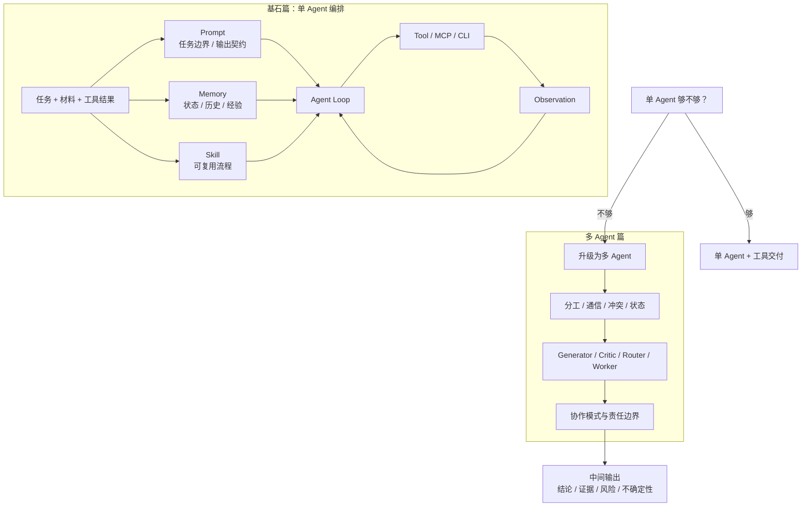
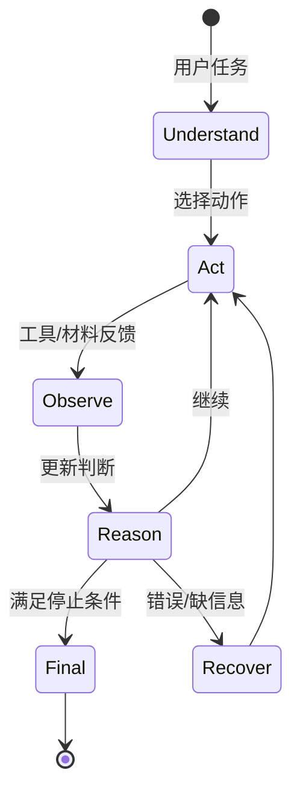
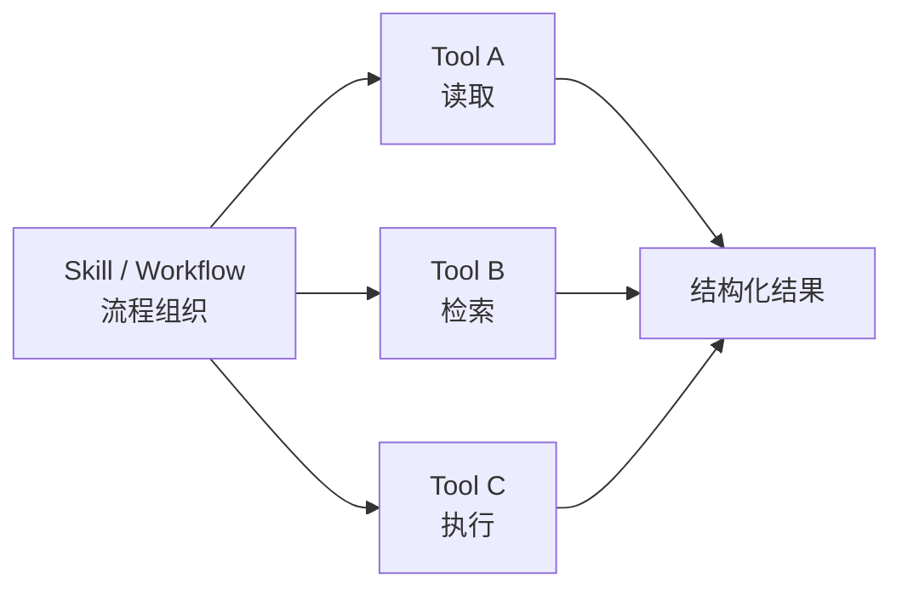
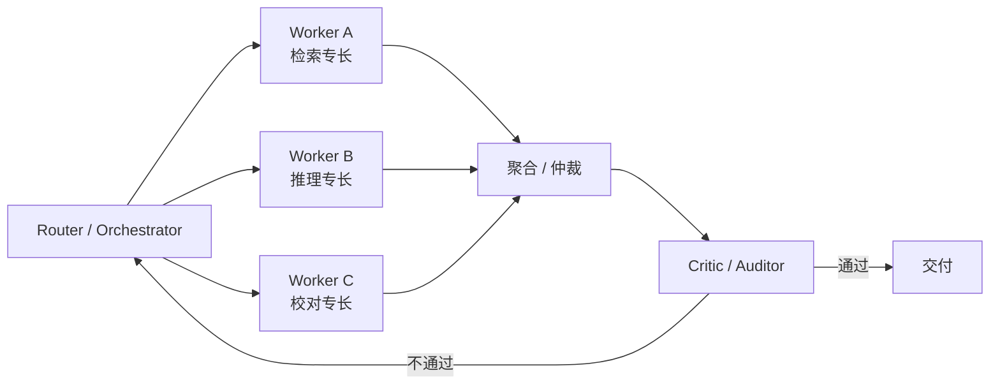
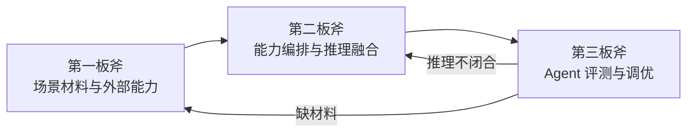

> **导航**：本文为《通用 Agent 设计方法论》系列第二篇。  
> ⬅️ 上一篇：[场景材料与外部能力设计（第一板斧）](/2026/10/23/agent-design-materials-and-capabilities/)  
> 📖 系列总览：[通用 Agent 设计方法论（四板斧）](/2026/10/22/general-agent-design-methodology/)  
> ➡️ 下一篇：[Agent 评测与调优（第三板斧）](/2026/10/23/agent-evaluation-and-tuning/)

---

> 🔍 **Folio 案例解析**  
> Folio 在第二板斧中用于说明 Session、Run、AgentEvent、WorkspaceContext、Skill 和 Workflow 如何协作，以及为什么只有出现真实失效信号后才升级 Router、Worker 或 Critic。阅读时只观察运行模型，不需要构建自己的 Runtime。

> 🎯 **一句话原则**  
> 先用单 Agent 把一个任务跑通，再判断它为什么跑不通——**跑不通的原因，往往就是该上多 Agent 的信号**。

Agent 拿到材料后，还没有完成设计。第二板斧要回答的是：**如何把材料、工具、提示词、记忆、技能和执行循环组织起来，让 Agent 能稳定完成任务；以及什么时候该从一个 Agent 升级为多个 Agent。**

这一板斧分两层推进：



> 📝 **核心边界**  
> 能力编排不是“写一个更长的 Prompt”，而是决定 Prompt、Memory、Skill、Tool、Loop 各自承担什么；多 Agent 不是“多个模型一起想”，而是角色、上下文、工具权限和责任边界的拆分。

---

## 一、基石篇：单 Agent 编排

在讨论多 Agent 之前，必须先把单个 Agent 的编排讲清楚。因为多 Agent 中的每一个 Agent，内部仍然是一套完整的单 Agent 编排。基石不稳，多 Agent 只是把不稳定放大若干倍。

### 1.1 Agent Loop 是执行骨架

Agent 的核心不是一次回答，而是循环：

```text
理解任务
  -> 选择动作
  -> 调用工具或读取材料
  -> 接收观察结果
  -> 更新判断
  -> 继续或停止
```

ReAct、Plan-and-Execute、Reflexion、LangGraph 等框架，本质上都在回答一个问题：**模型如何在状态、工具和反馈中推进任务**。

没有 Loop，Agent 容易退化成普通聊天；没有停止条件和错误恢复，Loop 又容易变成失控循环。



---

### 1.2 Prompt 是推理控制面

Prompt 不只是“让模型更听话”的文字。在 Agent 里，Prompt 至少承担几类职责：

| Prompt 职责 | 说明 |
| :--- | :--- |
| **任务边界** | 当前要做什么，不做什么 |
| **角色约束** | 用什么身份、语气和判断标准 |
| **输出格式** | 结果必须如何结构化 |
| **工具原则** | 什么时候该调用工具，什么时候不该调用 |
| **失败处理** | 信息不足、工具失败、低置信度时怎么做 |
| **证据约束** | 结论是否必须带来源、风险和不确定性 |

Prompt 应该控制的是当前任务的行为，不应该承载所有长期流程和全部背景知识。稳定流程应该沉淀为 Skill，长期信息应该进入 Memory 或知识系统。

---

### 1.3 Memory 管状态，Skill 管做法

Memory 和 Skill 经常容易被混淆：

| 概念 | 解决的问题 | 典型内容 | 常见误区 |
| :--- | :--- | :--- | :--- |
| **Memory** | Agent 知道了什么 | 当前任务状态、用户偏好、历史事实、任务轨迹、已验证结论 | 把 Memory 当全量聊天记录塞进去 |
| **Skill** | Agent 应该怎么做 | 任务步骤、检查清单、参考资料、模板、脚本、输出边界 | 把 Skill 当长 Prompt 或单个 Tool |

> **法则**：Memory 是状态和经验管理，Skill 是程序性流程沉淀。一个成熟的 Agent 不应该每次都重新发明工作流。

---

### 1.4 Tool 是执行原子，不是流程本身

Tool 负责做具体动作，例如读取文件、搜索、调用 API、查询数据库、运行命令。但 **Tool 不应该承载完整业务流程**。稳定流程应当由 Skill、Workflow 或图结构来组织，Tool 只是其中的原子能力。



工具越多，越需要路由、权限、上下文控制和结果治理。这部分能力入口的设计见第一板斧 [场景材料与外部能力设计](/2026/10/23/agent-design-materials-and-capabilities/)。

---

## 二、多 Agent 篇：何时升级、如何分工

基石篇解决的是“一个 Agent 怎么把一件事做完”。但有些任务，一个 Agent 就是做不好。这时候要问的不是“怎么把 Prompt 写得更长”，而是“是否该把任务拆给多个 Agent”。

### 2.1 什么时候单 Agent 不够

单 Agent 会在以下情况失效或退化：

| 单 Agent 失效信号 | 根因 | 该不该上多 Agent |
| :--- | :--- | :--- |
| **上下文越来越长，模型开始遗忘前文** | 上下文窗口与注意力稀释 | 先试压缩/外置（第三板斧 Token 审计），不行再拆 |
| **一个角色既要生成又要挑错，自审流于形式** | 生成者天然偏袒自己输出 | **该上 Generator + Critic** |
| **任务有天然可并行的独立子任务** | 串行执行浪费且互相干扰 | **该上 Router + Worker** |
| **不同子任务需要不同工具权限/不同系统访问** | 权限混在一起放大风险 | **该按角色隔离权限** |
| **任务需要不同专长（如检索+推理+校对）** | 单 Prompt 难以同时表达多种判断标准 | **该按专长分工** |
| **简单工具调用、单轮问答** | 本就不复杂 | **不该上多 Agent** |
| **只是为了显得架构高大上** | 徒增通信与调试成本 | **坚决不上多 Agent** |

> ❗ **多 Agent 的价值**  
> 多 Agent 的价值不是“多个模型一起想”，而是**角色、上下文、工具权限和责任边界的拆分**。如果拆完之后各 Agent 之间没有清晰的边界和交付契约，多 Agent 只是把混乱复制了 $N$ 份。

---

### 2.2 从单 Agent 到多 Agent 的升级决策

| 任务形态 | 推荐设计 | 核心关注点 |
| :--- | :--- | :--- |
| **单一查询、低风险** | 单 Agent + Tool | 简单直接，单步调用 |
| **稳定重复流程** | Skill / Workflow | 流程固化，减少模型漂移 |
| **多来源分析、可并行** | Router + Worker | 并行收集，聚合汇总 |
| **输出需要严密挑战** | Generator + Critic / Auditor | 对抗式校验，独立挑错 |
| **高风险动作** | Agent + HITL + 审计 | 关键写操作需人工介入确认 |
| **复杂长流程、需状态隔离** | 多 Agent 协作（Pipeline / 联合讨论） | 状态机驱动，上下文按阶段清空 |

---

### 2.3 多 Agent 架构的核心问题

进入多 Agent 后，需要回答四个关键系统设计问题：

1. **分工**：任务怎么拆？按角色、按阶段、还是按数据源？
2. **通信**：Agent 之间怎么传递中间结果？消息总线、共享状态、还是黑板模式？
3. **冲突**：结论不一致时谁说了算？投票、仲裁、还是升级人工？
4. **状态**：全局状态怎么维护？谁负责记录、谁负责恢复？



> 💡 **设计经验**  
> 多 Agent 不是高级装饰。一个任务如果没有清晰的子任务边界，强行多 Agent 只会增加通信成本、状态一致性问题和对齐难度。**先用单 Agent + Skill + 工具跑通，再根据失效信号决定是否升级**，比一上来就搞多智能体网络更稳健。

---

## 三、模块边界与使用时机速查

| 模块 | 边界 | 何时用 | 何时不用 |
| :--- | :--- | :--- | :--- |
| **Prompt** | 当前任务行为约束 | 任务边界/格式/工具原则需明确 | 长期流程、全部背景知识（用 Skill/Memory） |
| **Agent Loop** | 推理执行骨架 | 任务需要多步观察-行动 | 单轮问答、一次性生成 |
| **Memory** | 状态与经验管理 | 需跨轮次保留状态/偏好/结论 | 当成聊天记录全量塞入 |
| **Skill** | 可复用流程沉淀 | 流程已稳定重复 | 单个原子动作（用 Tool）、临场一次性任务 |
| **Tool** | 执行原子动作 | 读取/检索/调用/计算 | 承载完整业务流程 |
| **Multi-Agent** | 角色与责任拆分 | 任务天然可拆、需隔离上下文/权限、需独立 Critic | 简单任务、边界不清、仅为复杂而复杂 |

---

## 四、承上启下



* **向前依赖（第一板斧）**：
  - 没有可靠材料，推理会幻觉；
  - 没有明确工具，模型只能空想；
  - 没有权限边界，工具调用会放大风险。
* **向后输出（第三板斧）**：
  - 推理过程要能被 Trace；
  - 输出要带证据和不确定性；
  - 工具调用要能被审计；
  - 中间结论要允许被 Critic 挑战和重跑。
