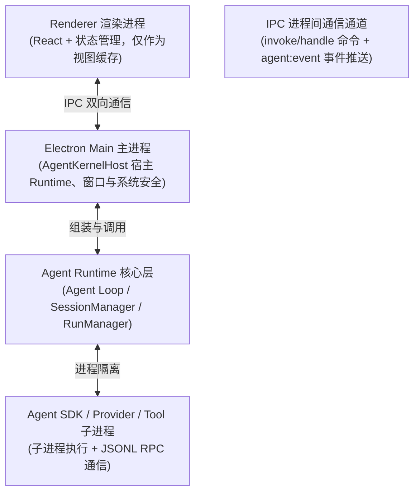
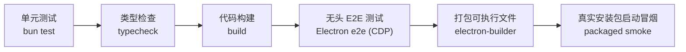

> **导航**：本文为《通用 Agent 设计方法论》系列第四篇（收官篇）。  
> ⬅️ 上一篇：[Agent 评测与调优（第三板斧）](/2026/10/23/agent-evaluation-and-tuning/)  
> 📖 系列总览：[通用 Agent 设计方法论（四板斧）](/2026/10/22/general-agent-design-methodology/)

---

> 🎯 **一句话原则**  
> 第四板斧不是前端课，而是把前三板斧做出来的 Agent Runtime 装进一个可交互、可持久化、可调试、可打包、可发布的桌面产品——**你要学的是“承载”本身的架构推导**。

> 📚 **案例说明**  
> 本章把 Folio 作为全栈产品承载的典型案例。先理解 Main、Preload、Renderer、Runtime、IPC、持久化和产品状态的关系，掌握承载层的设计取舍。

---

## 一、这一板斧要解决什么问题

前三板斧做完，你手里有一个高可用、能自愈的 Agent Runtime。但它本质上还是一个“黑盒代码库”：没有窗口、没有交互、没有安装包。

**用户拿到的不是裸 Runtime，而是产品。** 第四板斧回答：

> **如何把 Agent Runtime 组织成一个可交互、可持久化、可调试、可打包和可发布的全栈应用？**

先划清关注焦点：

| 核心关注 | 不把什么当主角 |
| :--- | :--- |
| **如何读懂、修改、调试、扩展一个真实全栈项目** | 不系统教 TypeScript 基础语法和 React 组件入门 |
| **Electron 三进程职责与 IPC 类型强契约** | 不死记硬背 Electron API 大全 |
| **Runtime 在桌面产品里的宿主模式与隔离** | 不逐行照抄开源项目全部业务源码 |
| **Loading / Empty / Partial / Stale / Error / Retry 状态** | 不纠缠于纯视觉 UI 装饰 |
| **打包、真实环境运行、视觉 QA 与发布门禁** | 不展开代码签名、公证等纯运维运维细节 |

---

## 二、分层心智模型

一个标准的桌面级 Agent 全栈产品通常由以下四层构成：



### 四层各自的“一句话职责”

| 层级 | 一句话职责 | 坚决不负责 |
| :--- | :--- | :--- |
| **Renderer** | 把事件流投影成 UI，Kernel 是事实源、Atoms 是视图缓存 | 不做业务决策、不直接碰底层 Runtime |
| **IPC** | Main 与 Renderer 之间唯一的受控通道，契约靠 Preload + 共享类型 | 不承载具体业务逻辑 |
| **Main / Kernel Host** | 宿主 Agent Runtime，注册 IPC Handler、管窗口和敏感凭证 | 不直接生成和渲染 UI |
| **Runtime / Provider** | 驱动 Agent Loop，产出事件流 | 完全不知道 Electron 的存在 |

### 两条铁律

1. **Renderer 不直接依赖 Runtime 底层类型**。跨进程的只有 Preload 暴露的 `ElectronAPI` 接口和纯类型包里的共享类型；底层 RPC 的内部类型坚决不泄露进渲染端。
2. **Kernel 是唯一事实源**。UI 状态只是事件流在前端的投影，窗口重启后靠事件流 Hydrate 重建，绝不靠前端组件自己记忆关键状态。

---

## 三、IPC：跨进程强契约怎么做

高质量的 IPC 设计需要恪守以下四条工程纪律：

### 1. 通道命名规范：`domain:action`

```text
sessions:create / sessions:listRuns / runs:start / runs:cancel
market:getQuote / market:getKline
llm:setModel / skills:* / research:* / thesis:*
```

一个领域一个明确前缀，一目了然。新增能力时，先思考“它属于哪个业务域”，再定义动作名。

---

### 2. 每个响应都封装为 `IpcResult` 统一信封

```ts
// 统一 IPC 信封格式
type IpcResult<T> =
  | { ok: true; data: T }
  | { ok: false; error: { code: string; message: string; action?: string } };
```

主进程中每个 Handler 都用统一方法封装：成功返回 `data`，失败返回 `code + message + action`。**错误里必须携带“下一步动作建议”**——让用户和前端知道出错后该怎么自愈。

---

### 3. 命令走 invoke，事件走推送

* **请求-响应模式**：Renderer 调用 `invoke('runs:start')` $\rightarrow$ Main `handle` 执行 $\rightarrow$ 返回 `IpcResult`。
* **事件推送模式**：Main 监听到每条 `AgentEvent` $\rightarrow$ `webContents.send('agent:event', event)` $\rightarrow$ Renderer 订阅并按 Sequence 依次更新视图。

> **原则**：一次 `invoke` 只做一次触发，过程进度全部单向通过事件流推给窗口。过程可完整观测，失败可精确定位。

---

### 4. 边界参数严格重验证

IPC 是跨进程的动态类型边界。无论前端 TypeScript 类型写得多么严格，Preload 传来的参数进入 Main 之后一律视为 `unknown`，必须在主进程里做显式校验（如白名单比对、属性存在性校验）后才能传入 Kernel。  
**类型活在源码里，不活在网络/IPC 传输线上。**

---

## 四、Runtime 宿主方式：Kernel 驻留 Main 进程

将整个 Agent Kernel 驻留于 Electron Main 进程具有天然优势：

```text
apps/electron/src/main/kernelHost.ts   AgentKernelHost：组装 + IPC handler
packages/shared/src/kernel/            AgentKernel / SessionManager / RunManager
packages/shared/src/agent/             PiRuntimeAdapter / PiRpcClient（子进程）
```

三条核心工程启示：
1. **Runtime 不感知 Electron**：Kernel 组织为独立的纯 Node/TS 包，完全可以脱离 Electron 进行单测与评测。
2. **双 Runtime 模式随时切换**：支持生产级真模型与本地 Mock Provider 快速切换（第一板斧“失败可降级”在客户端的落地）。
3. **事件订阅广播机制**：UI 只消费产品级抽象事件，底层 SDK 或模型原始数据在适配器内部清洗。

---

## 五、持久化：原子写入与仓储抽象

在桌面端，文件存储在足够简单可靠时应优先使用：

```text
userData/store/sessions.json             Session 索引
userData/store/sessions/<id>/messages.json
userData/store/sessions/<id>/runs.json   每 Session 独立目录，天然物理隔离
userData/thesis/<symbol>.json + index.json
userData/credentials.json                safeStorage 加密，敏感密钥不离开 Main
```

三条持久化规则：
1. **原子写入**：先写临时文件 `.tmp`，写入校验成功后再 `rename` 覆盖，彻底避免系统崩溃产生残缺的半截 JSON。
2. **仓储接口稳定，实现解耦**：业务代码只面向 `SessionRepository`、`RunRepository` 等接口编程，后续从本地 JSON 平滑迁移到 SQLite 时无需修改任何调用方。
3. **密钥安全隔离**：使用系统原生 `safeStorage` 加密存储 API Key，Renderer 进程永远拿不到敏感明文，杜绝 XSS 泄密风险。

---

## 六、产品状态：让 UI 会说“人话”

桌面级 Agent 绝不是只有一个简单的 Loading 转圈，必须严格设计以下六种产品状态：

| 状态 | 何时触发 | Renderer 侧落地表现 |
| :--- | :--- | :--- |
| **Loading** | 资源预热、材料抓取开始 | 骨架屏 + 当前阶段明确提示（如“正在检索财报数据...”） |
| **Empty** | 无 Session、无历史记录时 | 空态插画 + 起手提示词卡片引导 |
| **Partial** | 工具部分失败，但仍生成中间结论 | UI 明示缺失材料，给出置信度与部分成果 |
| **Stale** | 数据缓存超时（如 TTL 30s） | 新鲜度徽章提示，支持一键轻量刷新 |
| **Error + Retry** | 网络中断、模型限流、崩溃 | 明确报错原因，提供“一键重试最近指令”通道 |
| **视觉退化** | IPC 通道异常或服务降级 | 优雅兜底降级为空列表或占位提示，严禁整页白屏崩溃 |

> 💡 **设计准则**  
> UI 的核心追求不是炫酷，而是**在任何时刻，用户都能明确知道发生了什么、为什么会这样、下一步能做什么**。

---

## 七、TypeScript 工程组织最佳实践

1. **共享类型放独立 Package**：跨进程契约、核心领域实体（Session / Run / AgentEvent / ApiResult）放在无 Electron 依赖的纯 TS 类型包中，各模块单向引用，杜绝循环依赖。
2. **源码直连引用**：Monorepo 工作区中通过 Workspace 直连源码，统一严格度校验。
3. **类型即文档**：通过 Tagged Union（区分联合类型）让“成功与失败”的分支在类型系统中完全推导，杜绝模糊不清的 `any`。

---

## 八、视觉 QA 与发布门禁

在桌面端产品化过程中，发布门禁是保障交付质量的核心防线：



三条门禁纪律：
* 不涉及 UI 的逻辑回归测试全部采用后台无头模式运行，不弹可见窗口；
* 只有最后的 Packaged Smoke 阶段才允许启动真实可见窗口进行真实用户路径模拟；
* 视觉状态快照与打包产物哈希一并归档，形成不可篡改的 Release Gate 证据链。

---

## 总结：四板斧全景回顾

从场景出发，经历四步系统化推导：
1. **第一板斧（场景材料与外部能力）**：理清信息入口与动作入口，定好权限红线；
2. **第二板斧（能力编排与推理融合）**：单 Agent 闭环筑基，识别真实失效信号后再升级多 Agent；
3. **第三板斧（评测与调优）**：五维评测定交付标准，审计 Agent 定向回流自愈，Token 预算防成本失控；
4. **第四板斧（全栈产品承载）**：进程边界隔离，强类型 IPC 契约，完备状态机，打磨出工业级可信桌面应用。
