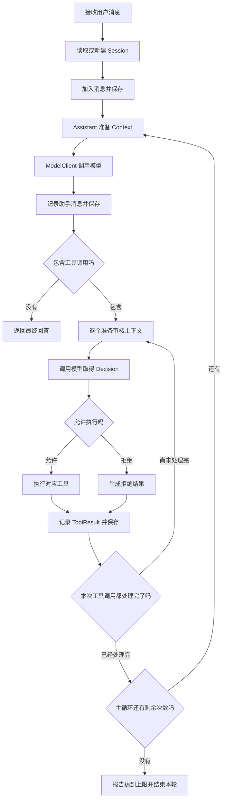
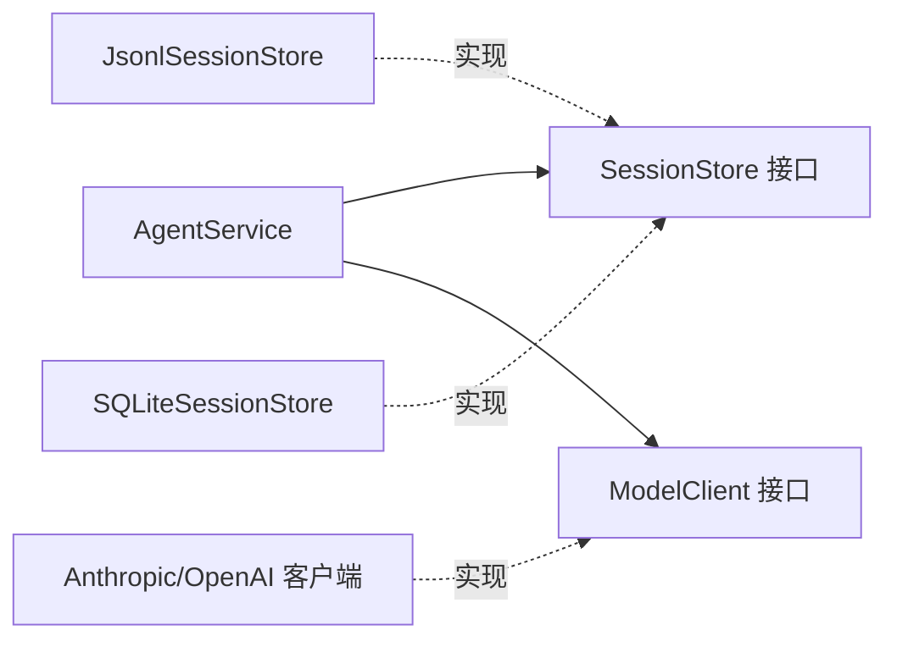
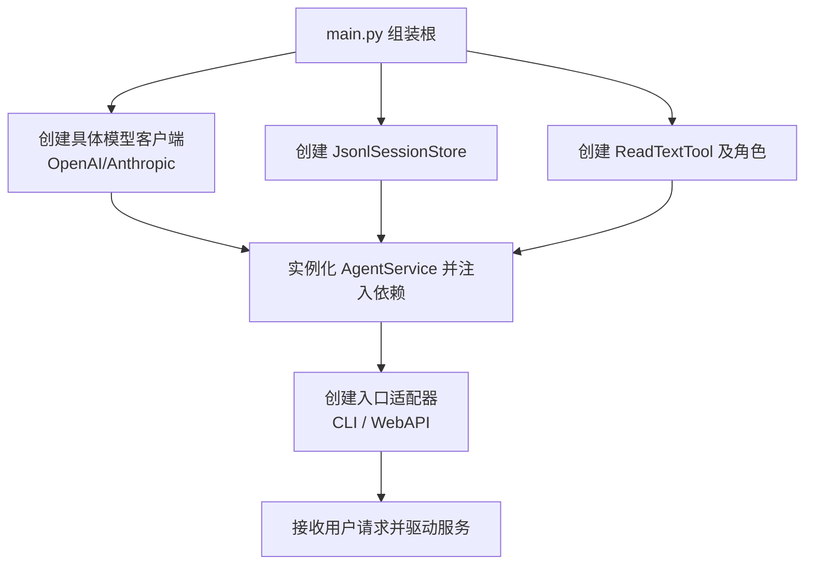

> 本文围绕一个**文件助手**（File Assistant），解释 Agent 怎样接收任务、调用模型、执行工具，以及怎样组织这些代码。只要看得懂 Python 的变量、函数和列表，就可以顺畅阅读。

读完后，你应该能回答四个核心问题：
1. 模型提出的工具调用，怎样变成真正的程序操作？
2. `Session`、`Context`、`ToolCall` 分别保存什么？
3. 领域层、应用层、适配层怎样分工？
4. 更换模型、存储或前端时，应该修改哪里？

> 💡 **参考出处**：参考自 [Hucci写代码《10分钟学会设计 Agent 架构》](https://www.bilibili.com/video/BV1winH6DEgt/)。本文保留视频的核心分层与流程设计，并补充完整的文件助手示例、Python 语法解释和实现步骤。

---

## 1 先弄清模型和程序各自负责什么

### 1.1 模型负责产生下一步建议

用户提出：“读取 `notes.txt`，用三句话概括内容。”模型可以根据当前信息，决定直接回答，或者先请求一个工具。

在工具调用流程中，模型会返回结构化信息，例如工具名称和参数。**文件读取发生在我们的程序里。**程序拿到这份请求后，找到对应的 Python 代码并执行，再把读取结果发给模型。

因此，做一个 Agent，需要把下面几部分接起来：

| 部分 | 白话解释 | 文件助手中的例子 |
| :--- | :--- | :--- |
| **模型** | 根据输入生成回复，或提出工具调用 | 决定先调用 `read_text` |
| **工具** | 能被程序执行的具体能力 | 从磁盘读取文本文件 |
| **会话状态** | 记录已经发生过的事情 | 用户任务、工具请求、文件内容、最终回答 |
| **控制流程** | 决定下一步做什么、什么时候结束 | 执行工具后再次调用模型 |
| **外部连接** | 处理模型接口、文件存储和网页请求 | 把内部消息转换成模型厂商要求的格式 |

### 1.2 Agent 的循环为什么重要

一次模型调用可能无法完成全部任务。文件助手第一次调用模型时，还没有文件内容。程序需要读取文件，然后再次调用模型，才能生成有依据的总结。

这就是 Agent 常见的工作方式：**模型决定下一步，程序执行允许的操作，把新结果带回下一次模型调用。**

> **核心原则**：**循环规则属于应用程序。**你需要决定是否允许工具、结果怎样记录、主循环最多进行多少轮，以及失败怎样向调用方报告。

### 1.3 Harness 是什么

视频开头提到的 **harness**，可以理解为围绕模型搭建的运行程序：它负责上下文准备、工具执行、会话存储和流程控制。模型提供推理与生成能力，这些外围代码负责让能力进入实际工作流程。

这里先研究单个 Agent 后端。把循环中的对象和职责理解清楚，就能看懂后续更复杂的实现。

---

## 2 用一个文件助手走完具体过程

假设 `notes.txt` 中有一段学习笔记：“*本周学习 Python，完成了列表和文件读写练习，下周继续学习函数。*”下面展示的是一次可能的交互，用来说明数据怎样流动。

### 第一步 记录用户任务

用户输入：“读取 `notes.txt`，用三句话概括内容。”程序把这句话放入当前会话。

```json
{
  "type": "user",
  "text": "读取 notes.txt，用三句话概括内容。"
}
```

### 第二步 准备上下文并调用模型

程序准备本次调用需要的信息：助手的指令、已有消息、可用工具，以及期望的输出类型。

例如，助手指令可以要求：“根据实际读取结果回答；需要文件内容时使用 `read_text`。”可用工具的说明会告诉模型，读取文件时应提供 `path` 参数。

### 第三步 模型提出工具调用

假设模型返回一条助手消息，其中包含下面的工具请求：

```json
{
  "id": "call_001",
  "tool_name": "read_text",
  "arguments": {
    "path": "notes.txt"
  }
}
```

这几个字段分别表示：这次调用的编号、要使用的工具，以及传给工具的参数。**此时文件还没有被读取。**

### 第四步 程序审核并执行

按照设计，程序先准备另一份上下文，让审核角色判断这次调用是否合理。允许执行后，再找到 `ReadTextTool.execute()`，完成真实文件读取。

读取成功后，程序记录结果：

```json
{
  "type": "tool_result",
  "tool_call_id": "call_001",
  "content": "本周学习 Python，完成了列表和文件读写练习，下周继续学习函数。"
}
```

`tool_call_id` 对应前面的 `id`。有了这个编号，程序和模型才能知道这段结果属于哪次调用。

### 第五步 再次调用模型并返回回答

程序把工具结果加入会话，重新准备上下文，再调用模型。这一次，模型已经可以看到文件内容，便可以生成总结。

当助手回复中没有工具调用时，程序结束当前轮次，把回答返回给用户。

> 💡 **重要区分**  
> 这一个用户任务，可能包含两次助手模型调用、一次审核模型调用和一次文件读取。**“一轮用户对话”和“一次模型调用”需要严格分开理解。**

---

## 3 把运行过程画出来

下面的图表示程序运行时的先后顺序：




*图 1 原视频 00:57。工具执行结果会进入下一次模型调用。*

这里有三个容易遗漏的细节：
1. 助手提出的工具调用需要先进入会话，随后才能追加对应结果。
2. 审核拒绝也是一种结果，需要让助手知道拒绝原因。
3. 达到主循环上限时，程序应明确报告当前任务尚未得到最终回答，不能把中间的工具请求当作完成结果。

每条新消息产生时进行持久化（保存到文件或数据库），后续请求才能恢复已有对话。

---

## 4 为什么把代码分成三层

刚开始写程序时，可以把全部流程放在一个函数里。但随着功能增加，这个函数可能同时出现 HTTP 请求、厂商消息格式、文件读写、工具审核和循环判断。修改其中一件事情时，就容易影响其他部分。

分层的目的，是让每部分代码有明确的工作范围：

| 层次 | 主要回答的问题 | 放入哪些内容 | 文件助手中的例子 |
| :--- | :--- | :--- | :--- |
| **领域层** (Domain) | 系统里有哪些概念，它们表示什么 | 会话、消息、工具调用、上下文、角色 | `Session`、`ToolCall`、`Context` |
| **应用层** (Application) | 为完成用户任务，要按什么顺序调用这些能力 | 主循环、业务入口、所需外部能力的接口 | `AgentService`、`ModelClient`、`SessionStore` |
| **适配层** (Adapter) | 怎样与具体外部系统交换数据 | 模型协议转换、文件存储、工具执行、HTTP 入口 | 模型客户端、`JsonlSessionStore`、`ReadTextTool`、`WebApi` |

### 4.1 领域层定义系统自己的语言

`Session` 表示一次会话，`ToolCall` 表示一次待执行的工具请求。先把这些概念定义清楚，其他代码才能使用同一套含义。

领域对象不需要知道 API 密钥，也不需要知道网页请求来自哪个地址。它们描述的是系统内部的数据和规则。

### 4.2 应用层安排工作顺序

`AgentService` 负责安排：读取会话、添加消息、调用模型、审核工具、保存结果、继续循环或结束。

它需要存储和模型调用能力，所以在应用层声明 `SessionStore`、`ModelClient` 两个接口。接口约定怎么调用，具体工作交给适配层实现。

### 4.3 适配层负责具体连接

模型厂商可能把工具名称、消息和参数组织成不同格式。适配器负责把内部的 `Context` 转换成厂商请求，再把厂商回复转换为内部对象。

存储也一样：程序中的 `Session` 是一个 Python 对象，写进 JSONL 文件时需要转换成 JSON 数据。读取文件时，再把数据恢复为程序使用的对象。


*图 2 原视频 02:27。同一份会话可以对应文件中的 JSON 数据，也可以对应数据库记录。*

### 4.4 遇到一段代码时怎样判断放在哪里

可以按下面三个问题判断：
- 这段代码在定义“会话、工具或审核结论是什么”吗？$\rightarrow$ **领域层**
- 这段代码在安排“先做什么、后做什么”吗？$\rightarrow$ **应用层**
- 这段代码在处理厂商协议、文件格式、网络或真实工具操作吗？$\rightarrow$ **适配层**

---

## 5 领域对象怎样用 Python 表示

### 5.1 对象可以理解为带名字的数据集合

Python 字典已经可以保存数据：

```python
call_data = {
    "id": "call_001",
    "tool_name": "read_text",
    "arguments": {"path": "notes.txt"},
}
```

当同一种结构被很多地方使用时，可以为它定义一个类型，让字段和含义更容易查找。

使用 Python 3.10 及以上版本的语法：

```python
from dataclasses import dataclass, field


@dataclass
class ToolCall:
    id: str
    tool_name: str
    arguments: dict[str, str]


@dataclass
class UserMessage:
    text: str


@dataclass
class AssistantMessage:
    text: str
    tool_calls: tuple[ToolCall, ...] = ()


@dataclass
class ToolResult:
    tool_call_id: str
    content: str


Message = UserMessage | AssistantMessage | ToolResult


@dataclass
class Session:
    id: str
    messages: list[Message] = field(default_factory=list)

    def append(self, message: Message) -> None:
        self.messages.append(message)
```

逐项理解这段代码：
- `@dataclass` 自动生成初始化方法，可以直接写 `ToolCall(id=..., tool_name=..., arguments=...)`。
- `UserMessage | AssistantMessage | ToolResult` 使用联合类型表示会话中的消息类型。
- `tuple[ToolCall, ...]` 表示可以包含多个工具调用；空元组 `()` 表示没有工具调用。
- `field(default_factory=list)` 为每个新会话创建独立的消息列表，避免不同会话共享同一个列表引用。

> ⚠️ **注意**：**类型标注主要帮助阅读和静态类型检查，不会自动检查模型返回的实际运行时数据。**外部回复仍需要在模型适配器中完成解析和防御性校验。

### 5.2 实际消息追加顺序

```python
session = Session(id="session_001")
session.append(UserMessage(text="读取 notes.txt 并总结"))

call = ToolCall(
    id="call_001",
    tool_name="read_text",
    arguments={"path": "notes.txt"},
)

session.append(
    AssistantMessage(text="先读取文件内容。", tool_calls=(call,))
)
session.append(
    ToolResult(tool_call_id=call.id, content="这里是已经读取到的文件内容。")
)

print(len(session.messages))  # 输出 3
print(session.messages[2].tool_call_id)  # 输出 call_001
```

### 5.3 为什么 ToolCall 和 ToolResult 要分开

`ToolCall` 保存“准备执行什么”，`ToolResult` 保存“执行后得到什么”。两者发生在不同时间，也可能有不同结果（例如被安全审核拒绝）。使用独立的结果对象，就能精确地把结果和原请求通过 `tool_call_id` 关联起来。


*图 3 原视频 04:00。Session 保存消息列表，助手消息中可以包含 ToolCall。*

---

## 6 Session 和 Context 为什么需要分开

这两个对象都涉及消息，但生命周期与关注点截然不同：

| 对象 | 主要用途 | 生命周期 | 举例 |
| :--- | :--- | :--- | :--- |
| **`Session`** | 记录一段会话已经发生的事情 | 可以跨越多次用户请求 | 保存用户消息、助手回复和工具结果 |
| **`Context`** | 准备某一次模型调用需要的输入 | 通常为一次调用即时创建 | 为回复任务选择指令、消息和可用工具 |

> 简单比喻：**`Session` 是档案室记录，`Context` 是为了本次开会而临时整理的公文包。**公文包从档案室调取部分记录，再塞入本次会议的专项指令和可用工具目录。

### 6.1 Context 中的四个基本字段

| 字段 | 表示什么 | 文件助手中的例子 |
| :--- | :--- | :--- |
| `instruction` | 这次调用要完成的任务和规则 | 根据实际文件内容总结 |
| `tools` | 本次模型可以请求的工具 | `ReadTextTool` |
| `messages` | 这次调用要看到的历史消息 | 用户任务和已经读取的内容 |
| `output_type` | 程序期望的输出对象类型 | `AssistantMessage` 或 `Decision` |


*图 4 原视频 06:26。同一套上下文结构可以用于回复用户，也可以用于审核工具。*

### 6.2 Context 中的泛型理解

`Context[O]` 中的泛型 `O` 可以直接理解为“本次模型调用预期返回的类型”：
- `Context[AssistantMessage]`：这次调用预期得到助手回复；
- `Context[Decision]`：这次调用预期得到审核结论。

这种设计让不同任务共用 Context 的基本框架，同时在类型层声明各自的输出契约。

### 6.3 Context 可以与原始历史不同

历史变长后，可以完整保留 `Session`，同时为模型组装“早期摘要 + 近期滑动窗口消息”作为 `Context`。给审核任务和生成任务也可以提供不同裁剪维度的上下文。

---

## 7 接口和依赖倒置究竟解决什么问题

### 7.1 接口是一份方法约定

`SessionStore` 告诉调用方：存储需要提供哪些方法、接受什么输入、返回什么结果：

| 方法 | 用途 |
| :--- | :--- |
| `list()` | 列出已保存的会话 |
| `save(session)` | 保存一个会话 |
| `load(session_id)` | 根据编号读取会话 |

在 Python 中使用 `typing.Protocol` 表达结构性子类型约定：

```python
from typing import Protocol


class SessionStore(Protocol):
    def list(self) -> list[Session]: ...

    def save(self, session: Session) -> None: ...

    def load(self, session_id: str) -> Session: ...
```

这里的 `...` 表示仅声明方法签名，具体读写由具体存储类（如 `JsonlSessionStore`）实现。

### 7.2 依赖倒置（DIP）的精髓

应用层知道自己的流程需要存储能力，但不需要关心存储究竟是本地 JSONL、SQLite 还是远程 MongoDB。

应用层提出 `SessionStore` 接口约定，具体实现在适配层完成。**业务流程依赖抽象，外部实现遵从抽象。**



### 7.3 更换实现时的改动范围

| 改动场景 | 通常修改的位置 |
| :--- | :--- |
| 在已有客户端中更换模型名称 | `ModelSettings` 或启动配置 |
| 换成项目已经实现的另一家客户端 | 组装根（`main.py`）中的传入对象 |
| 接入此前没有支持的模型协议 | 新增 Adapter 实现，并调整组装根 |
| 从 JSONL 换成数据库存储 | 新增对应 Store 实现，再调整组装根 |
| 新增 Web API 或 CLI 入口 | 新增入口适配器，内部调用 `AgentService` |

---

## 8 ModelClient 怎样连接模型

`ModelClient` 是应用层调用模型的统一门面：

```python
reply = model_client.generate(context, model_settings)
```

适配层内的具体客户端完成三件事：
1. **转换输入**：把内部 Context、消息和工具契约转换成特定厂商请求格式（如 OpenAI Tools 格式或 Claude ToolUse 格式）；
2. **发送网络请求**：处理鉴权、重试、流式或单次响应；
3. **转换输出**：解析厂商响应，还原为系统内部统一的 `AssistantMessage` 或 `Decision`。


*图 5 原视频 07:23。统一门面抹平了底层各厂商接口差异。*

---

## 9 工具怎样从说明变成真实操作

一个完整的工具需要兼备两部分：

| 部分 | 谁会使用 | 用途 |
| :--- | :--- | :--- |
| **元数据（名称、说明、参数 Schema）** | 模型 | 帮助模型判断何时使用、该填什么参数 |
| **`execute(arguments)` 实现** | Agent 程序 | 在本地执行真正的副作用并返回结果 |

```python
from pathlib import Path


class ReadTextTool:
    name = "read_text"
    description = "读取指定工作目录内的 UTF-8 文本文件"
    parameters = {
        "type": "object",
        "properties": {
            "path": {"type": "string", "description": "相对文件路径"}
        },
        "required": ["path"],
        "additionalProperties": False,
    }

    def __init__(self, root: Path):
        self.root = root.resolve()

    def execute(self, arguments: dict[str, str]) -> str:
        path = arguments["path"]
        if not isinstance(path, str):
            raise TypeError("path 必须是字符串")

        target = (self.root / path).resolve()
        if not target.is_relative_to(self.root):
            raise PermissionError("只允许读取指定工作目录内的文件")

        return target.read_text(encoding="utf-8")
```

### 运行时工具派发

```python
from pathlib import Path

# 注册工具
read_tool = ReadTextTool(root=Path("workspace"))
tools = {read_tool.name: read_tool}

# 收到工具调用意图后执行
content = tools[call.tool_name].execute(call.arguments)
result = ToolResult(tool_call_id=call.id, content=content)
```

---

## 10 为什么分出 Assistant 和 ToolCallReviewer

回复用户和安全审核的目标截然不同，因此拆分为两个独立角色负责组织各自的上下文：

* **Assistant**：持有业务 Prompt 与可用工具列表，为模型组织面向生成任务的 `Context[AssistantMessage]`；
* **ToolCallReviewer**：持有安全规则与审计 Prompt，把当前会话与待执行的 `ToolCall` 作为审查材料，组织面向审核的 `Context[Decision]`。

```python
from dataclasses import dataclass


@dataclass
class Decision:
    should_allow: bool
    reason: str | None = None
```


*图 6 原视频 08:28。Assistant 期望助手消息，审核角色期望 Decision。*

---

## 11 AgentService 怎样把所有步骤接起来

### 11.1 服务对象的持有依赖

| 属性 | 职责 |
| :--- | :--- |
| `model_client` | 模型调用门面 |
| `session_store` | 读取、保存和列出会话 |
| `assistant` | 组装回复上下文 |
| `reviewer` | 组装工具审核上下文 |
| `assistant_model_settings` | 回复角色使用的模型参数（如强推理模型） |
| `reviewer_model_settings` | 审核角色使用的模型参数（如快速轻量模型） |
| `max_iterations` | 防止死循环的最大轮次门限 |


*图 7 原视频 09:08。服务对外提供会话管理和消息收发核心主循环。*

### 11.2 主循环核心骨架

```python
def chat(self, session_id: str, user_message: str) -> str:
    # 1. 记录用户输入并落盘
    session = self.session_store.load(session_id)
    session.append(UserMessage(text=user_message))
    self.session_store.save(session)

    tools = {tool.name: tool for tool in self.assistant.tools}

    # 2. 启动驱动循环
    for _ in range(self.max_iterations):
        context = self.assistant.context(session)
        reply = self.model_client.generate(
            context, self.assistant_model_settings
        )
        session.append(reply)
        self.session_store.save(session)

        # 没有工具调用，说明已得出最终回答
        if not reply.tool_calls:
            return reply.text

        # 3. 处理工具调用
        for call in reply.tool_calls:
            review_context = self.reviewer.context(session, call)
            decision = self.model_client.generate(
                review_context, self.reviewer_model_settings
            )

            if decision.should_allow:
                content = tools[call.tool_name].execute(call.arguments)
            else:
                content = f"工具调用被拒绝：{decision.reason}"

            result = ToolResult(tool_call_id=call.id, content=content)
            session.append(result)
            self.session_store.save(session)

    raise RuntimeError("达到主循环上限，尚未得到最终回答")
```

---

## 12 组装根（Composition Root）

业务流程面向接口编程，系统启动时总要实例化具体对象并将它们装配在一起。这个位置称为**组装根**（通常是 `main.py`）。




*图 8 原视频 09:50。main.py 负责具体的依赖注入与服务启动。*

### 推荐的轻量目录布局

| 文件 | 层次定位 | 主要内容 |
| :--- | :--- | :--- |
| `domain.py` | 领域层 | `Session`、消息类型、`ToolCall`、`Context`、`Decision` |
| `application.py` | 应用层 | `SessionStore`、`ModelClient` 协议接口、`AgentService` |
| `model_adapter.py` | 适配层 | 特定大模型 API 的请求与响应转换 |
| `storage_adapter.py` | 适配层 | `JsonlSessionStore` 具体文件读写 |
| `tools.py` | 适配层 | `ReadTextTool` 等具体工具操作 |
| `cli.py` | 入口层 | 命令行读取与交互展示 |
| `main.py` | 组装根 | 实例化所有对象并启动服务 |

---

## 13 循序渐进的动手实现清单

| 步骤 | 任务模块 | 验证标准 |
| :---: | :--- | :--- |
| **1** | 领域对象与 Session | 能实例化会话并按顺序追加各类型消息 |
| **2** | 最小工具实现 | 真实读取工作区文件，越界路径抛出权限异常 |
| **3** | 本地存储实现 | 会话保存后能重新加载，且消息顺序完全一致 |
| **4** | 真实模型适配器 | 成功发起 API 请求，能正确解析工具意图并还原为内部对象 |
| **5** | Agent 主循环 | 工具结果能注入下一轮请求，最终输出有依据的结论 |
| **6** | 安全审核角色 | 审核阻断和通过均能正常记录并引导后续流程 |
| **7** | 交互入口 | 通过命令行或测试脚本完整跑通整个链路 |

---

## 14 进阶练习与扩展思考


*图 9 原视频 11:04。分叉与压缩扩展思考。*

1. **分叉对话（Branching Session）**：
   从已有 Session 的第 $k$ 条消息处切出新会话分支。需注意处理 `ToolCall` 与 `ToolResult` 的成对一致性，避免分支恢复后遗留孤立未完成的工具调用。
2. **对话上下文压缩（Context Compaction）**：
   当会话变长时，保持底层 `Session` 记录全量历史，但在组装 `Context` 时将前段历史动态提炼为结构化摘要，在保证推理事实依据的前提下大幅节省 Token。

---

## 附录：核心术语速查表

| 术语 | 白话含义 |
| :--- | :--- |
| **Agent** | 以大模型为核心推理引擎，通过观察—行动循环自主调用工具解决任务的程序 |
| **Harness** | 围绕模型搭建的外围控制脚手架（上下文组装、工具派发、状态落盘与循环控制） |
| **Session** | 会话持久化实体，记录业务全局已发生的所有事实历史 |
| **Context** | 专为单次模型推理调用组装的临时数据包 |
| **ToolCall** | 模型发出的结构化工具调用意图（名称 + 入参） |
| **ToolResult** | 工具在真实环境执行后产生的客观结果数据 |
| **Domain** | 领域层，表达核心概念与数据结构，不依赖任何第三方框架 |
| **Application** | 应用层，调度业务流程与主循环，定义对外所需能力的接口 |
| **Adapter** | 适配层，实现具体外部技术细节（模型协议、数据库、真实 OS 指令） |
| **Composition Root** | 组装根，整个应用程序中唯一知道所有具体技术实现的装配点（通常是 `main.py`） |
