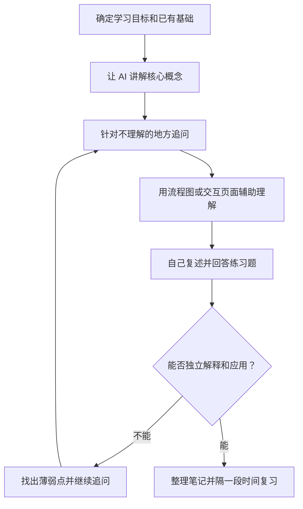
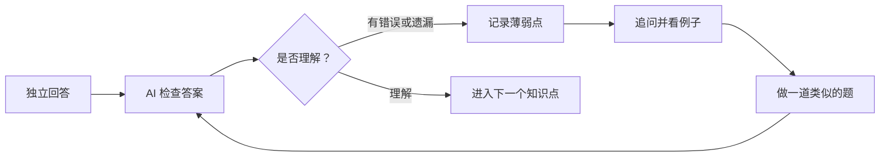

> AI 可以充当随时交流的**专属学习伙伴**：帮你解释概念、拆解流程、设计习题和检查思路。但真正的理解永远需要自己复述、练习和验证，不能停留在“看懂了 AI 的回答”这一浅层错觉。

---

## 核心学习流程

---

## 1. 先确定学习目标

不要一开始就让 AI 把一个领域的全部知识大而全地讲完。先确定自己要解决什么问题，以及准备学到什么程度。

例如，学习 Python 的 `async` 和 `await` 异步机制时，可以把初阶目标定为：
* 知道它们到底解决什么问题（I/O 密集型阻塞）；
* 能看懂一个简单的异步请求示例代码；
* 能清楚说出什么时候适合使用它们、什么时候没必要使用。

同时在对话伊始便**告诉 AI 自己的技术基础与背景**，这样它能更精准地选择类比方式与讲解深度。

> 💬 **提问模板**  
> “我想学习【知识点】，我的基础是【已有基础】。我的目标是【希望做到的事情】。请先列出理解这个知识点需要掌握的 3～5 个核心概念，再用通俗易懂的语言逐个解释。专业术语后面请附上白话解释。”

---

## 2. 围绕问题反复追问，拆碎概念

先让 AI 给出整体框架，再针对不理解的地方逐步追问。**一次只解决一两个小问题**，更容易清晰定位自己到底卡在哪个认知断层。

可以从以下 5 个维度发起追问：
* **是什么（What）**：这个概念到底是什么意思？
* **为什么（Why）**：它解决了什么痛点问题？为什么前人没有它不行？
* **怎么用（How）**：能给一个最简可运行的最小示例（Minimal Reproducible Example）吗？
* **怎么区分（Compare）**：它和我已经知道的某概念有什么本质区别？
* **有什么限制（Constraint）**：什么时候不适合使用？常见踩坑与误区是什么？

如果 AI 给出的解释仍然太抽象，可以要求它“换一个生活中的类比”，或者给出一个具体的业务场景。学习代码时，可以让 AI 逐行解释关键语法背后的设计原因。

> 💬 **追问示例**  
> “我不理解【具体内容】。请先用生活中的例子解释，再用一个最小代码示例说明。每一行代码请解释它的作用和这样写的原因。”

---

## 3. 用可视化辅助理解抽象逻辑

很多技术知识包含多步流转、对象依赖或状态机变迁。单纯面对长篇大论的文字容易陷入迷失，此时可以让 AI 生成 **Mermaid 流程图**，甚至生成具备交互功能的 **HTML 控件页面**。

* **Mermaid 图表**：适合展示时序逻辑、分支调用、类关系和数据流动，可以直接在 Markdown 笔记中即时渲染。
* **交互式 HTML 页面**：适合通过按钮点击、状态切换、参数微调观察过程。例如：点击按钮模拟单线程事件循环的任务队列执行时序。

> 💬 **生成图示模板**  
> “请用 Mermaid 流程图解释【知识点】，突出【需要理解的过程或关系】。图中使用简短的中文标签，并在图后逐一解释每一步。”

> 💬 **生成交互页面模板**  
> “请生成一个可以在浏览器中直接打开的单文件 HTML，用简单的交互式 UI 演示【知识点】。页面应包含【需要展示的步骤或参数】，并用中文解释每次操作带来的状态变化。”

---

## 4. 费曼式自测：让 AI 出题与判卷

当你觉得自己已经“看懂”时，先停下来，不要继续被动输入。让 AI 根据学习目标出几道针对性习题，**逼迫自己提取记忆、组织语言作答**。

题目设计可以循序渐进：
1. **概念题**：用自己的话解释核心概念的定义；
2. **过程题**：口述或画出某个核心机制的主要流转步骤；
3. **应用题**：在具体给定的边界场景中选择合适的技术方案并论证原因；
4. **纠错题**：排查并修复一段故意写错逻辑的代码或伪命题。

> 💬 **出题提示词模板**  
> “请根据我们刚才讨论的【知识点】出 4 道题，从基础概念到实际应用逐渐增加难度。请先不要给出参考答案，等我逐一回答后，指出我的认知错误和遗漏点，并解释原因。”

---

## 5. 动手运行与多源验证

必须清醒认识到：**大语言模型的回答、生成的代码和绘制的图示都存在幻觉可能。**

* **代码必须亲手跑**：涉及编程实现时，将代码复制到本地环境实际运行，验证输出是否与预期完全相符；
* **关键结论查阅第一手官方文档**：遇到涉及底层规范、性能参数或存在争议的内容，一定要查阅官方 API Reference 或一手源码验证；
* **多模型对抗交叉检验**：当不同资料存在矛盾时，把两方观点丢给 AI 进行对比推演，再回到原始权威文献确认。

---

## 6. 自己整理结构化笔记，定期主动复盘

学完之后，**切忌直接无脑复制粘贴整段 AI 输出**。必须逼迫自己进行一次信息重组：

一份高价值的学习笔记应包含：
* **明确目标**：这次具体解决了什么实际问题？
* **核心心智模型**：用自己最自然的语言提炼的一句话原则；
* **最小证明骨架**：保留最能讲清问题的一个最小示例或 Mermaid 流程图；
* **边界与禁忌**：什么时候坚决不用？有哪些常见陷阱？
* **易混淆点对比**：做题和排查时踩过的坑；
* **权威来源依据**：官方文档链接、RFC 或一手论文；
* **主动回想问题卡（Self-Quiz）**：留 2～3 个未来过一周能独立回答的测试问题。

---

## 总结

高效掌握新知识的闭环公式：  
$$\text{明确目标} \longrightarrow \text{定向追问} \longrightarrow \text{可视化还原} \longrightarrow \text{费曼出题自测} \longrightarrow \text{实操验证} \longrightarrow \text{沉淀笔记与间隔复习}$$
