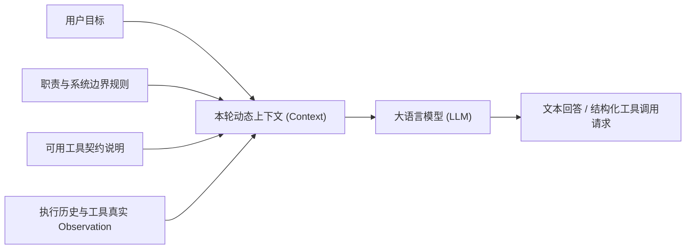
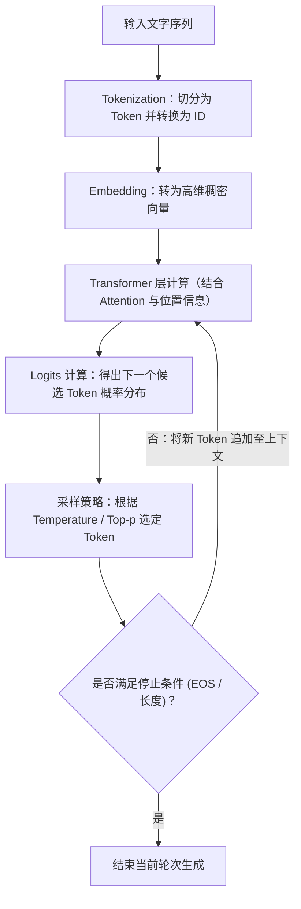
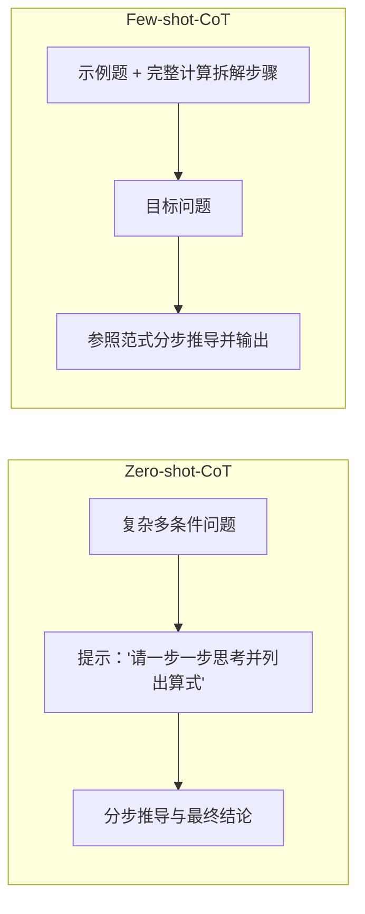
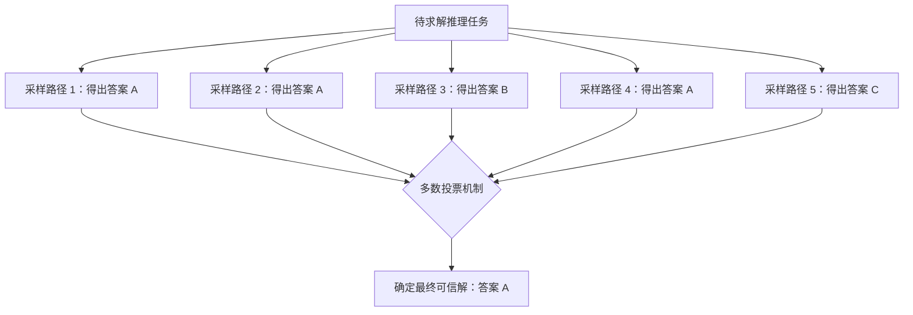
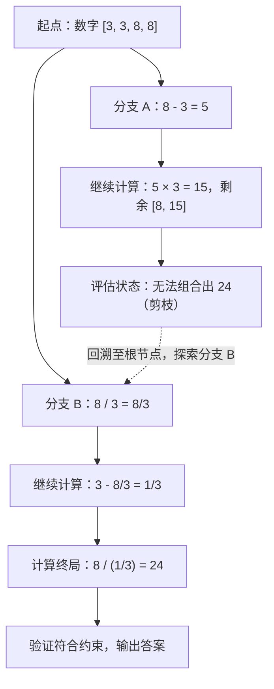
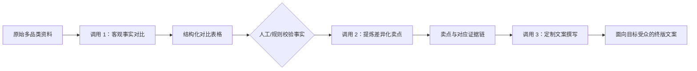
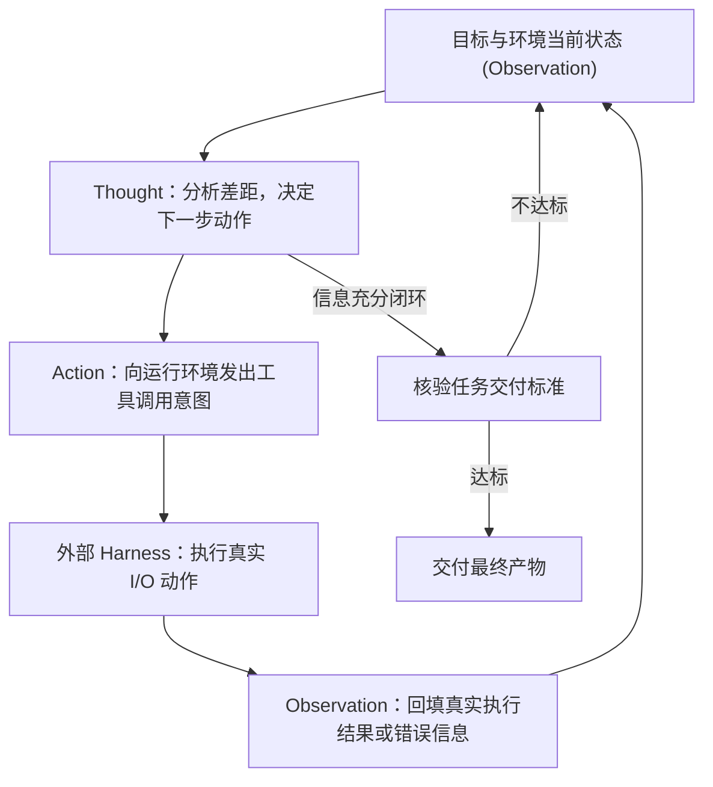
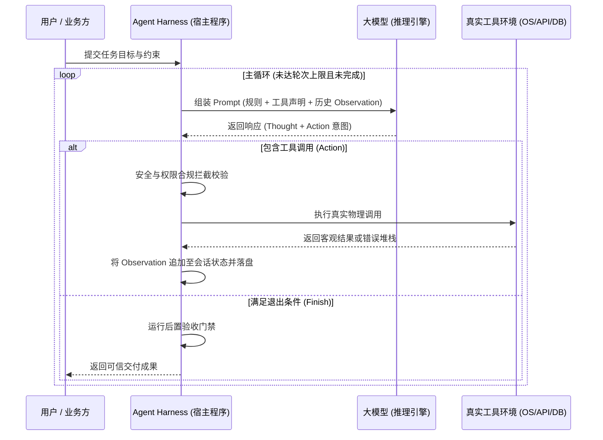

> 让大模型说明“怎样统计一个文件夹里的发票”，与让它读取文件、计算金额、核对结果，需要截然不同的系统能力。前者主要生成回答；后者还要操作外部环境，根据执行结果决定下一步。
>
> 本文梳理怎样把需求交代清楚，怎样组织中间推理与方案搜索，怎样串联多次调用，以及 **ReAct 架构怎样将推理与真实环境操作打通闭环**。

---

## 核心全貌：方法图谱与解决痛点

| 方法 | 一句话心智模型 | 典型直观示例 |
| :--- | :--- | :--- |
| **RTF-C** | 严密交代角色、任务、格式与背景约束 | 说明初学者背景，请模型给出按部就班的学习计划 |
| **Few-shot**（少样本提示） | 给定若干输入输出范例，固化标准与边界 | 展示 3 种典型客户反馈的分类，再处理新反馈 |
| **CoT**（思维链） | 强制生成显式中间推理步骤，再输出终解 | 先核算原有库存，再扣减出库，最后追加补货 |
| **Self-consistency**（自一致性） | 对同一问题多路采样，多数投票汇总结果 | 5 次独立解题得到 3 个 408，以 408 作为最终结果 |
| **ToT**（思维树） | 中间节点探索多分支，评估可行性，支持剪枝与回退 | “24 点”解题：当前计算分支走不通时回退重试 |
| **Prompt Chaining**（提示词链） | 任务解耦为多次线性调用，上一阶段输出作为下一阶段输入 | 先完成产品客观对比，再提炼差异卖点，最后撰写文案 |
| **持续调优** | 根据真实 Badcase 归因，补齐边界后回归验证 | 发现模糊反馈总被误判为故障，追加“信息不足”判别规则 |
| **ReAct** | 推理（Thought）、行动（Action）与观察（Observation）交替循环 | 读取发票发现为扫描件，自发决策调用 OCR 补充提取 |

---

## 一、提示词是什么？模型如何生成回答？

### 1.1 提示词是本轮收到的全量上下文

Prompt 就是提供给模型的全部输入。在对话场景中，它不仅包含用户提问，还包含系统提示词与历史；**而在 Agent 场景中，提示词是由运行环境动态组装的“全量资料包”**：



> 用户输入只是本轮上下文的触发点，真正的推理依据来自系统规则、工具说明与环境反馈。

### 1.2 自回归 Token 生成机制

语言模型将文本拆分为 Token（可能是一个字、一个词或子词），并以自回归方式逐 Token 计算概率分布并生成：



* **Attention 机制**：让模型在计算当前 Token 时动态聚焦上下文中最关键的前序信息；
* **为什么要把需求说清楚？** 任务要求的约束文本直接存在于上下文中，会通过 Attention 权重持续纠偏后续每个 Token 的生成概率分布。

### 1.3 幻觉（Hallucination）与防御手段

语言模型优化的是“概率上最自然的连贯文本”，并不天然自带“事实真实性核对”。防范幻觉的核心实践：
1. **提供可靠资料源**：限定上下文依据，要求结论必须注明来源；
2. **允许回答“不知道”**：未在资料中明确证实的内容，强约束标记为“资料未提及”，杜绝脑补推测。

---

## 二、RTF-C：需求结构化清单

RTF-C 是构建严谨提示词的经典检查清单：

| 维度 | 核心说明 | 示例 |
| :--- | :--- | :--- |
| **Role（角色）** | 设定关注视角与专业语境 | “你是一位面向 Python 初学者的编程教练。” |
| **Task（任务）** | 明确处理目标与具体作业边界 | “制定为期 2 周的文件处理学习计划，每周 5 小时。” |
| **Format（格式）** | 约定结构化输出协议与交付形式 | “使用 Markdown 表格，第一次出现专业术语时立即附带一句通俗解释。” |
| **Context（背景）** | 补充影响最终判断的关键先验条件 | “学员只会变量与基础循环，尚未学习 pathlib，目标是读取并统计发票。” |

> 📌 **长文本排序效应（Lost in the Middle）**：在长上下文任务中，模型对置于开头与结尾的信息关注度显著高于中间。关键约束与判定规则建议置于提示词开头或结尾。

---

## 三、Few-shot：用范例固化边界

单纯用自然语言描述规则往往存在歧义，Few-shot（少样本提示）通过“输入—输出”样本直接固化判定标准：

```text
将客户反馈严格分类为：“功能建议”、“使用故障”、“其他”。

分类规则：
- 明确要求新增未有能力：功能建议
- 明确指出已有功能报错/无法使用：使用故障
- 情绪宣泄或信息不足以支撑定位：其他

示例 1：
输入：希望支持按标签筛选发票
输出：功能建议

示例 2：
输入：点击导出 PDF 提示系统崩溃
输出：使用故障

示例 3：
输入：这导出功能真不好用
输出：其他

待分类输入：批量导出时界面闪退
输出：
```

> **要点**：示例需具备典型性与多样性，重点展示**容易混淆的边界案例**（如区分“真故障”与“信息不足”）。

---

## 四、CoT：通过中间推理步骤求解

CoT（Chain of Thought）通过引导模型显式输出中间推导过程，提升复杂条件判断与数值计算的准确率。



* **原理**：自回归生成中，前序计算出的中间结果（如已完成第一步加减的数量）会变成后续推理的硬性上下文依据，显著降低单步推理跨度；
* **边界**：CoT 依然依赖模型内部参数知识；如果缺乏底层客观数据，继续空想推理毫无意义，必须借助外部工具检索。

---

## 五、Self-consistency：多路径采样投票

对于存在确定性客观答案的推理任务（如数学计算、逻辑推演），单次生成的思维链可能因局部计算失误而导致全盘皆错。

**自一致性（Self-consistency）**：
1. 以非零温度（Temperature > 0）对同一问题并行采样 $N$ 条（如 5~10 条）独立推理路径；
2. 提取每条路径的最终答案；
3. 通过多数投票（Majority Vote）决定最终输出。



---

## 六、ToT：树状思维探索与回溯

在复杂决策或探索性问题中（如写代码方案架构、24 点计算），单一向前推演极易陷入死胡同。**思维树（Tree of Thoughts, ToT）** 将推理建模为树形搜索空间：



表达式求解结果：
$$
\frac{8}{3 - \frac{8}{3}} = 24
$$

### 核心三要素
1. **Thought Generator**：在当前节点生成多个候选推进动作；
2. **State Evaluator**：评估当前中间状态的可行性（Sure / Likely / Impossible）；
3. **Search Algorithm**：利用 BFS（广度优先）或 DFS（深度优先加回溯）遍历搜索树。

---

## 七、Prompt Chaining：工作流式的阶段解耦

当业务链条清晰、且后一步强烈依赖前一步的可验证成果时，强行把全部诉求塞进单次提示词会导致模型顾此失彼。**提示词链（Prompt Chaining）** 采用多次调用解耦复杂度：



> **核心收益**：各阶段输入输出具备显式契约，出现错误时可以秒级定位责任阶段（事实抄错查 Phase 1，卖点夸大查 Phase 2，语气不符查 Phase 3）。

---

## 八、ReAct：推理与行动的交替自愈循环

前面的所有方法本质上依然停留在“纯文本闭门思考”层面。当遇到真实业务世界的文件读取、数据库查询、API 交互时，模型必须进化为 **ReAct（Reasoning + Acting）**。



### 真实案例：发票统计任务中的动态分支

| 轮次 | Thought（内部推理） | Action（工具调用） | Observation（真实环境反馈） |
| :---: | :--- | :--- | :--- |
| **Round 1** | 需要先摸清目录内发票范围 | `list_files(dir="./invoices")` | 返回 `[inv01.pdf, inv02.pdf, inv03.pdf]` |
| **Round 2** | 读取 3 份发票的金额与日期 | `read_pdf(files=...)` | 前两份成功提取；**第 3 份无文字图层（扫描件）** |
| **Round 3** | **根据反馈自发纠偏**：inv03 需切入 OCR 识别 | `ocr_pdf(file="inv03.pdf")` | 成功识别金额 20 元，日期 9 月 15 日 |
| **Round 4** | 汇总三笔金额：100 + 80 + 20 | `calculate(expr="100+80+20")`| 返回计算结果 200 |
| **End** | 所有文件核实完毕，符合口径 | `finish()` | 交付带明细与总额的结构化报告 |

> 💡 **关键质变**：当第二轮遇到扫描件时，下一步不是按僵化配置执行，而是**基于环境返回的异常信息自主决策调用 OCR**。这就是 Agent 动态适应能力的核心体现。

---

## 九、Agent Harness：谁在驱动大模型？

大模型本身只是一个“无状态的文本/Token 预测函数”，它没有执行网络 I/O、读写磁盘或终止循环的能力。**真正让大模型跑起来的是 Harness 运行宿主程序**：



### Harness 的四大核心职责
1. **上下文组织者**：负责组装 Prompt，管理短期上下文与 Token 压缩截断；
2. **工具调度分派器**：解析模型的 JSON/ToolCall 意图，完成参数校验与真实物理执行；
3. **安全与权限卫士**：对写操作、删除操作施加目录隔离与人工确认（HITL）；
4. **状态与状态机维护**：记录持久化 Session 事实日志，限制最大 Loop 次数防止死循环。

---

## 十、技术选型决策矩阵

面对新任务时，应按照**“最简可用原则”**逐步引入复杂度，切忌盲目上重型架构：

| 业务场景特征 | 推荐选型 | 核心收益与关注点 |
| :--- | :---: | :--- |
| **回答经常出现答非所问、格式飘逸** | **RTF-C** | 极低成本，补齐角色、边界与格式约定 |
| **分类标准主观，纯自然语言讲不清** | **Few-shot** | 用 3~5 个正反与边界案例拉齐判定基准 |
| **数据已知，但涉及逻辑推导与算术计算** | **CoT** | 强制拆解中间步骤，暴露可复核证据链 |
| **高可靠要求计算题/客观题，允许一定成本** | **Self-consistency** | 多路径采样投票，平滑单次随机扰动 |
| **解空间庞大，需多方案探索与中途纠偏** | **ToT** | 树状搜索，中途剪枝与回溯评估 |
| **业务步骤固定，前序产出驱动后序输入** | **Prompt Chaining** | 阶段工程解耦，定位 Bug 极其精确 |
| **需与外部系统交互，根据反馈动态推演** | **ReAct + Harness** | 具备自主行动能力与环境自愈能力的完整 Agent |

---

## 总结

大模型演化为 Agent 的路径清晰而笃定：  
**用清晰需求界定范围 $\rightarrow$ 用少样本范例锚定边界 $\rightarrow$ 用思维链展开逻辑 $\rightarrow$ 用思维树探索最优解 $\rightarrow$ 用提示词链拆解阶段 $\rightarrow$ 用 ReAct 连通物理世界。**  
最后，通过坚固工程化的 **Agent Harness** 负责权限管控、状态落盘与循环调度，大模型方能真正从“聊天的玩具”进化为“可托付任务的智能体”。
