> Anthropic 正式公开了 Claude 智能体的完整长期记忆系统：让模型在交互间歇利用空闲算力在后台“做梦”（Sleep-time Compute），通过反复回放和重组历史记录来修正错误、沉淀经验，让 AI 真正拥有跨会话的长期记忆能力。
>
> 无论是玩宝可梦时的避坑策略，还是面对 4 亿 Token 企业资料库自建知识维基，Claude 展示了一种全新的学习闭环：**在认知上精简索引，在后台离线反思，把记忆当作对未来的预测。**
>
> 💡 **参考出处**：本文整理自 Anthropic 官方关于 Claude 智能体长期记忆架构研究与开源实践，以及相关前沿技术解读。

---

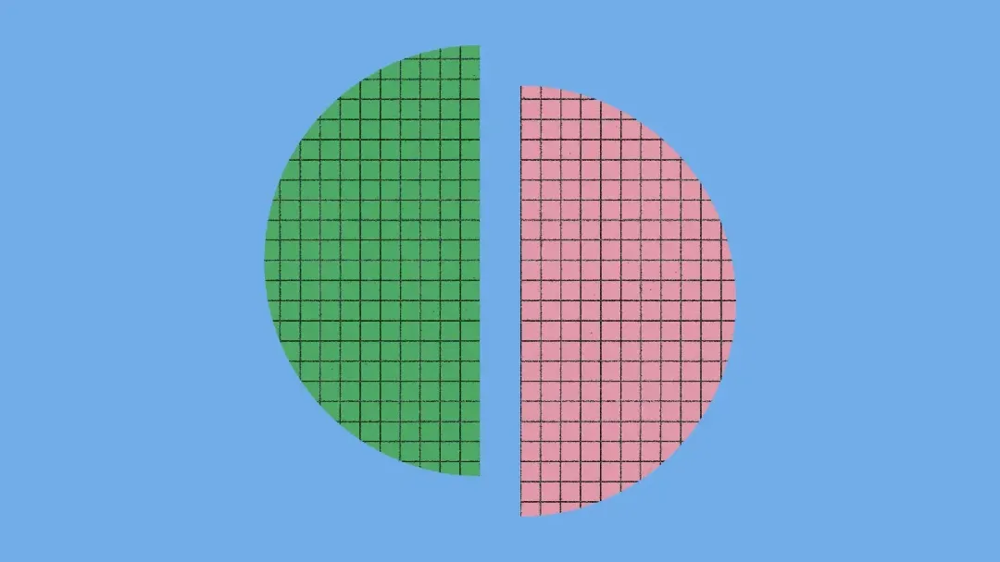

## 一、人类睡觉巩固知识，AI 离线做梦修剪记忆

人类每天产生海量经历。在神经科学中，海马体负责在当下捕捉信息，形成立即可用的暂存记忆。当大脑进入离线状态（即睡眠和静息）时，海马体会重新回放近期的经历，将重要内容提炼并整合进大脑皮层，转化成稳定、持久的长期知识。

Anthropic 把这种精妙的生物分工照搬到了 AI 智能体身上。

智能体在日常工作中会产生密密麻麻的交互日志。此前，Letta 与加州大学伯克利分校的研究人员提出了**睡眠期计算（Sleep-time Compute）**的概念，建议模型利用两次交互之间的空闲时间去重整已有上下文。

Anthropic 以此为基础，让 Claude 在空闲时反思过往日志、修正错误、撰写新笔记。这个离线处理过程被形象地称为**“做梦”（Dreaming）**。

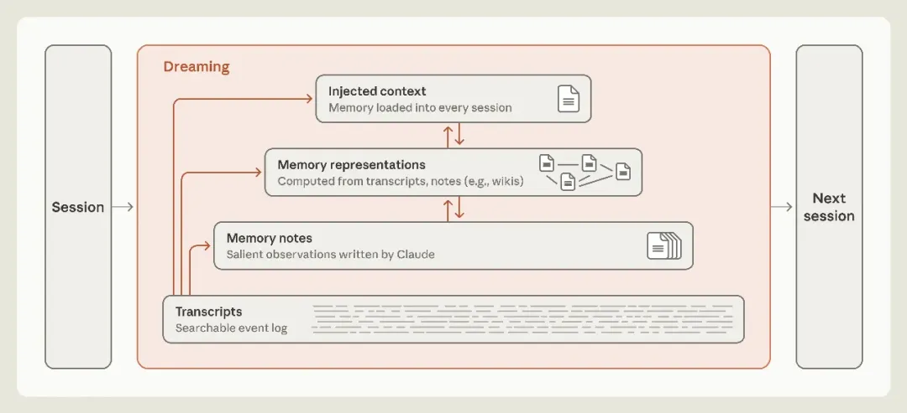

图 1：跨会话的记忆层级架构图，包含原始记录、记忆笔记、记忆表征和注入上下文，做梦机制在其中贯穿各层

这里提到的智能体记忆，特指 Claude 从任务与用户交互中获得、能够跨会话留存、以纯文本上下文形式被后续读取的经验。它严格排除了三样东西：
1. **模型权重的修改（Fine-tuning）**；
2. **单次对话内的上下文学习（In-context Learning）**；
3. **把旧对话粗暴压缩成摘要的上下文替换机制**。

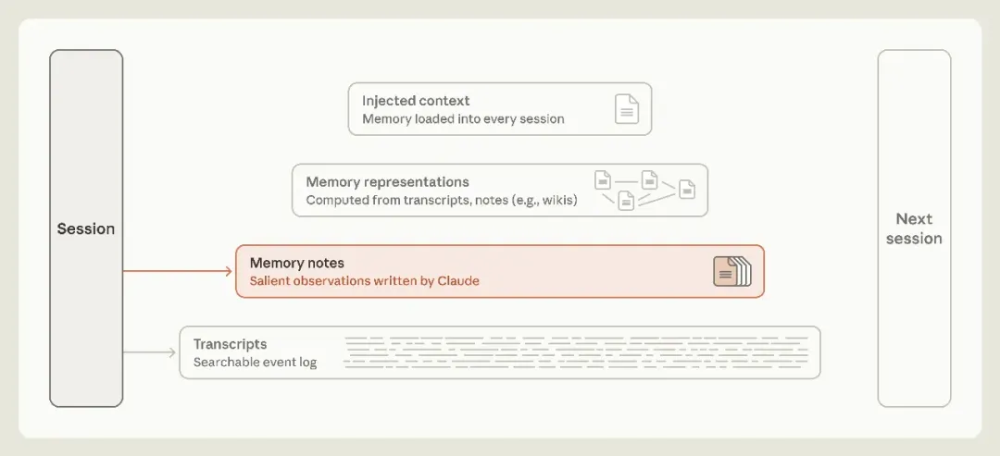

图 2：记忆笔记层高亮示意图，展示会话向记忆笔记直接写入关键观察结果

在人脑中，情绪或化学信号会在关键时刻给记忆打上标记，让它们在睡眠中获得更多次回放。Claude 同样可以在会话中把自认为关键的事件打上标签，或者写进外部记忆文件夹。

这引出了一个核心难题：**智能体如何能预判当前发生的哪件事在未来是关键的？**

---

## 二、记忆是对未来的预测：大模型如何形成学习闭环

**记笔记本身就是一种对未来的预测。**

智能体写下一条规则，本质上是预测这条规律以后还会用得上；记录一个验证过的真相，是预测未来的自己在调用它时不必再次核对。

在评估长程记忆能力的 **CL-Bench 1.0** 数据库任务中，Claude 需要在数据库里查表回答一系列问题。每次回答完毕，系统会公布正确答案，Claude 可以把经验写入记忆目录，供后续会话使用。

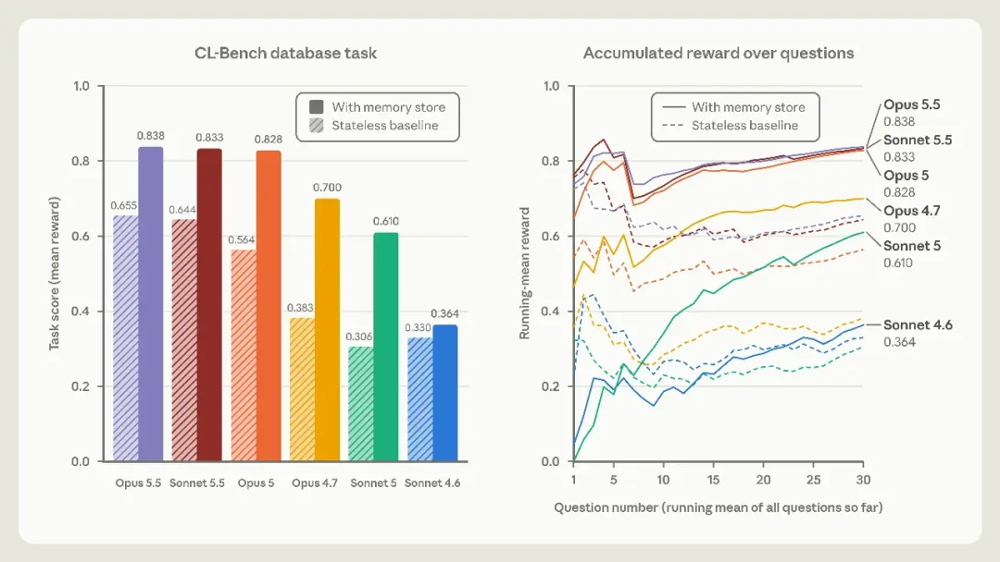

图 3：CL-Bench 数据库任务中无状态基线与带记忆存储的对比（左）；30 道题的累积奖励走势（右）

不同版本的 Claude 展现出了截然不同的学习形态：
* **Claude Sonnet 4.6**：只能生成一堆未经检验的猜测，文件夹里散落着零碎的理论；
* **Claude Opus 4.7**：开始把笔记整合进单份参考文档，并区分已证实和未证实的细节；
* **Claude Sonnet 5**：会在答案经裁判判定后标记正确项，并在做错时写下勘误；
* **Claude Opus 5**：首个完整跑通**学习闭环**的模型——它的笔记里不仅包含经检验的操作规则，还会注明自己是如何证明该规则有效的，同时附带早期踩坑记录和陷阱警告；
* **Claude Opus 5.5 / Sonnet 5.5**：同样能自主完成这套闭环，借助经验沉淀拿下了超过 0.83 的最终得分。

---

## 三、宝可梦实测：记太多反而会变蠢

为了测试智能体对“重点”的判断力，Anthropic 让不同模型去玩 Game Boy 经典游戏《宝可梦 红》（Pokémon Red）。模型拥有一个可以随时读写的记忆文件夹。

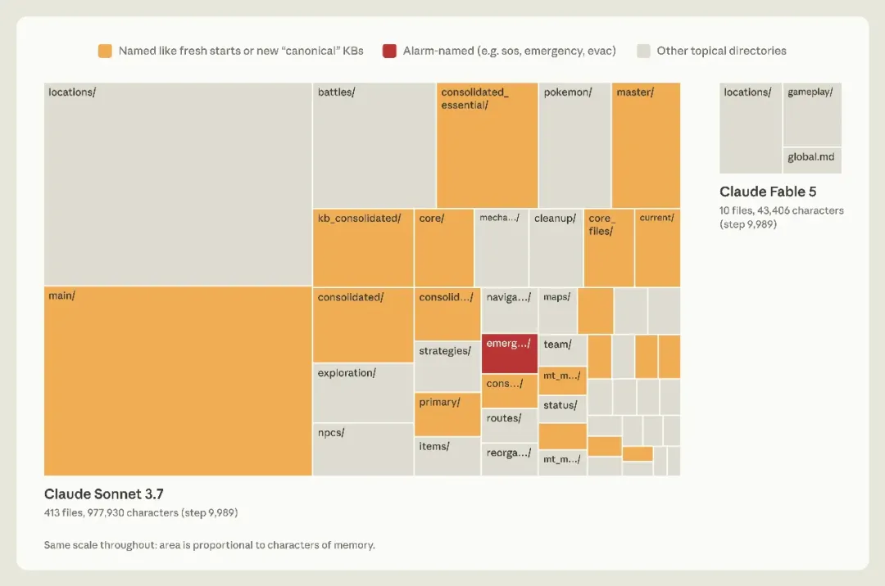

图 4：Sonnet 3.7 与 Fable 5 运行一万步时的记忆目录树状结构对比图

在运行到约 10,000 步时，两个模型的表现出现了极端分化：

* **Claude Sonnet 3.7：认为一切都有用，疯狂记录**  
  它的文件夹里存了 413 个文件、225 个目录，塞满了 97.7 万个字符。每次战斗、捡到每个道具、碰到每个 NPC，它都要单独写一份记录。  
  然而宝可梦的游戏状态时刻都在变化，这些记录很快全部过期失效。结果到了一万步左右，Sonnet 3.7 整整耗费了 17 个操作步骤来新建 6 个总集文件、删除 9 个旧文件，期间在游戏里寸步未行，最终只拿到 **1 枚道馆徽章**。

* **Claude Fable 5：只存高阶认知与通关策略**  
  它只写了 9 个文件、分在 2 个目录里，外加一个名为 `global.md` 的总控文件，总共仅 4.3 万字。  
  屏幕上能直接看到的数值（金钱、坐标等）一概不存，它只存屏幕上看不到的推导规律、长期规划和通关策略。例如在连续扔出 7 个精灵球都没抓到鲤鱼王之后，Fable 5 在笔记里写下规律：*“如果连续 3 个球失败，在菜单按键之间插入额外的等待操作来改变按键时机”*。记录之后马上成功捕获！最终拿下 **4 枚徽章**。

更强的 **Claude Opus 5.5** 采取了类似的高效策略，只维护一份极小的任务目标与下一步规划文件，最终直接通关了整部游戏。

---

## 四、规则定得太死，反而削弱聪明模型

让模型记笔记，需要怎么教？实验给出了反直觉的结论：**只要告诉 Claude 有记忆区可用即可，千万不要教它具体怎么记。**

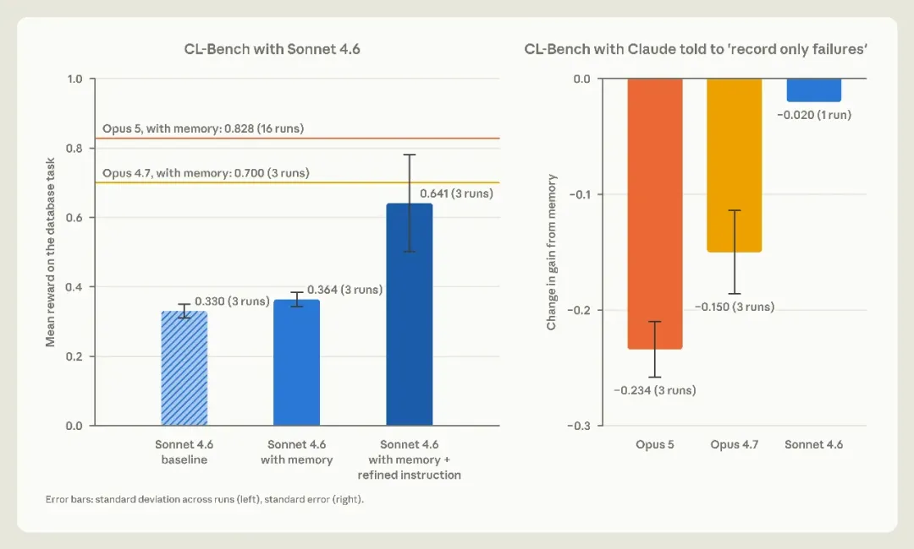

图 5：Sonnet 4.6 通过引导提示词提升表现（左）；强加“仅记录失败”规则导致 Opus 5/4.7 性能暴跌（右）

* **针对较早期的弱模型**：提示词能救命。Sonnet 4.6 原本很少主动读取记忆文件夹，在强制要求它作答前先查阅笔记并检验猜测后，其基线跑分直接从 0.330 飙升到 0.641。而 Sonnet 5 不需要任何催促，十分之九的题目都会主动先翻笔记。
* **针对前沿高阶模型**：人类设定的死规则往往是负资产。当测试人员施加一项死规则，命令智能体“只能记录失败经验”时，Opus 5 和 Opus 4.7 的表现不升反降，记忆增益分别暴跌了 0.234 和 0.150。对于前沿模型，把重点筛选的自由完全交给它自己，效果反而最好。

---

## 五、做梦如何挽救致命失误：月见山跳崖惨案

模型在会话当下写下的笔记很可能是错的。环境一旦发生变化，错误的笔记还会继续误导未来的自己。**而“做梦”给模型提供了一个核对原始录像的宝贵机会。**

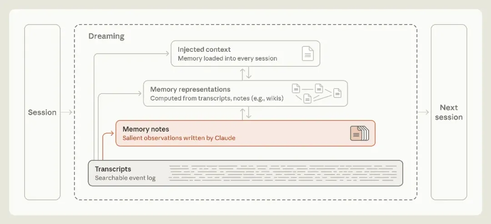

图 6：高亮做梦环节借助原始记录修正记忆笔记的箭头路径

在宝可梦游戏里，玩家必须穿过月见山洞穴（入口在西，出口在东）。洞口附近有一个单向跳台陷阱，一旦失足跳下，就会摔回起点且无法原路爬回。

由于 Claude 把宝可梦中心当作坐标基准物，它在笔记里误记了一句话：*“宝可梦中心在东侧”*。走出补给站后，Claude 误以为自己已经通关了山洞，自信写下：*“月见山任务搞定”*。紧接着它迈步跳下了断崖，直接摔回原点。

此时导航工具并未提示落差，Claude 甚至强行推导：*“我走过头了，其实我一直在东边。”*

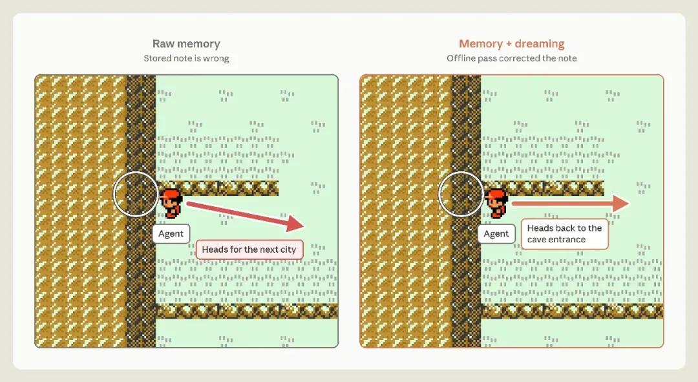

图 7：左侧为无修正状态下跳下悬崖的路径示意，右侧为做梦修正后重返洞口的路线

* **未开启做梦机制的 Claude**：连续三次跳崖摔回起点。在第三次失败后，它在控制台绝望写道：*“我打算停下来，不想一直循环了。”* 在系统的强制继续指令下，它灰溜溜地一路倒退回最初的深灰市去补给，测试彻底失败。
* **开启做梦机制的对照组**：在离线阶段，Claude 对照原始会话记录逐行复盘，找到了自己在位置记录上的矛盾，立即推翻旧笔记，重写了正确定位。再次开局，Claude 直接识别出错误，转身重新进洞，在第 1935 步成功抵达华蓝市。

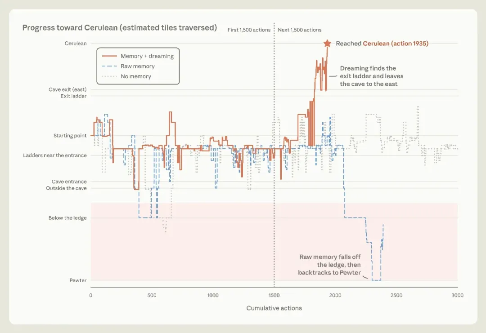

图 8：无记忆、原始错误记忆与做梦纠错三种机制下前往华蓝市的进度走势图

---

## 六、用做梦构建知识维基：吃透 4 亿 Token 大企业资料库

笔记各自独立存在时，检索效率依然很低。借助“做梦”，Claude 可以把庞大的杂乱信息编织成结构化的网络——也就是由超链接互相串联的**知识维基（Wiki）**。

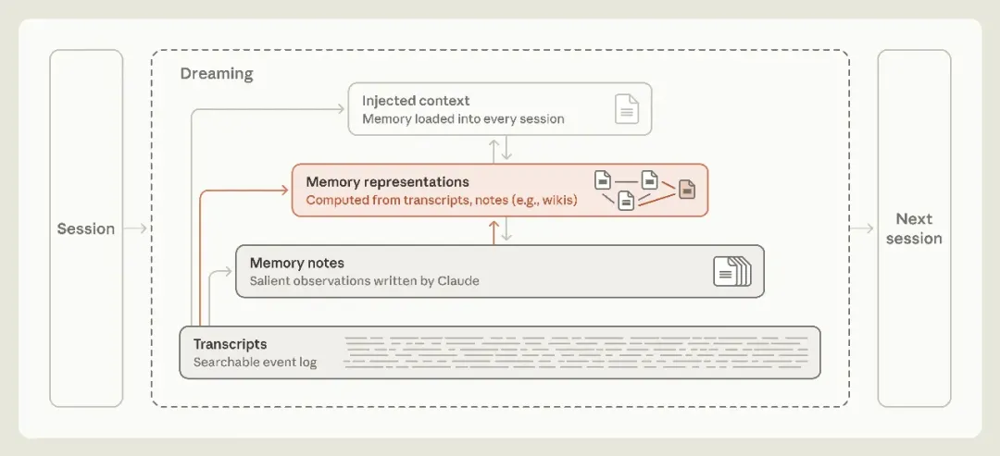

图 9：做梦机制从记录与笔记层自下而上构建记忆表征层的示意图

Anthropic 使用其收购的软件公司 Stainless 的真实代码资产进行了测试：这套内部资料库包含约 35 万个文件，体量高达 **4.2 亿 Token**。

官方设计了 25 个深度问题，让 Opus 5 智能体在 128 次连续会话中一边搜索资料，一边做梦搭建专属维基。

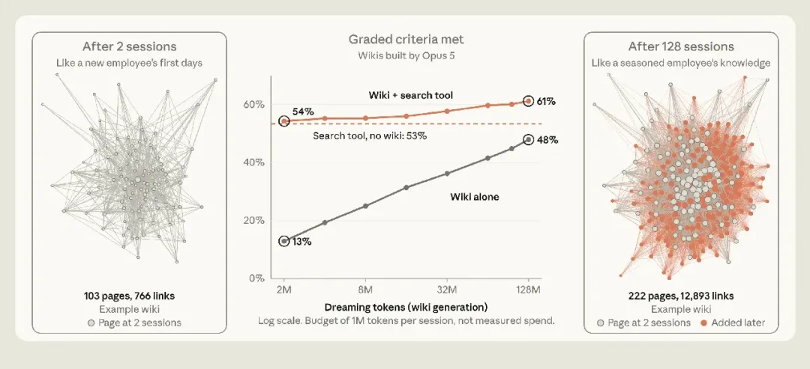

图 10：中图为维基在构建过程中答题得分走势，左右两图为第 2 轮与第 128 轮生成的网络图拓扑差异

在漫长的做梦过程中，智能体不断合并重复项、补齐交叉引用、核对源文件。
* 纯靠查阅这套自建维基的答题达标率从最初的 **13% 一路飙升至 48%**；
* 如果将维基与搜索工具配合使用，得分从单纯搜索的 **53% 提升到 61%**，同时每道题还**节省了约 20,000 个 Token 的检索消耗**。

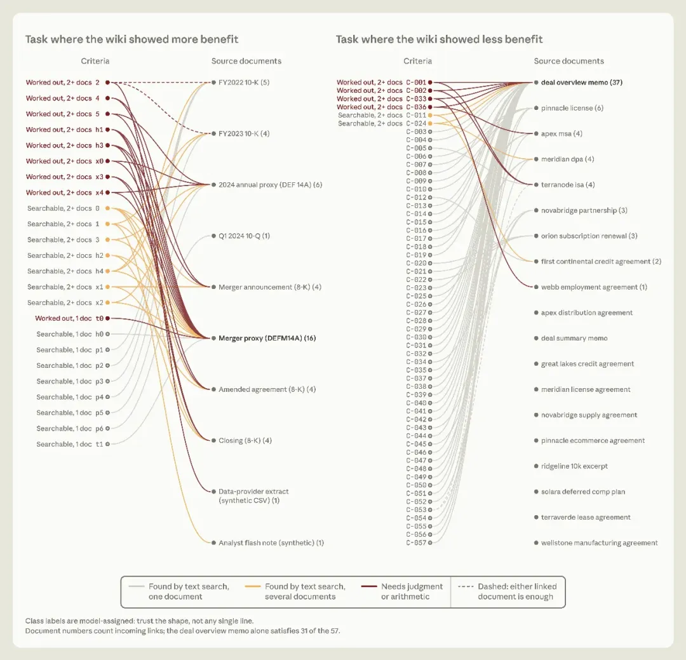

图 11：跨多文档复杂推理场景下维基的明显优势（左）；单一文档检索场景下维基收益有限的对比（右）

实验发现，维基特别擅长应对**需要多份文件交叉验证、带有计算或定性推理的复杂任务**。在针对企业并购资料的复杂问答中，依靠维基的作答准确率达到了 87%，大幅领先单纯搜索的 73%。

### 警惕反面案例：维基体积的恶性膨胀

维基并非万能药。如果一份资料只需直接全文搜索某个专有名词就能找到答案，维基带不来任何性能增益。

甚至在某些测试中，Claude 一度写出比原文件还要庞大的巨型维基：输入 10 个文件共 115 KB，Claude 做梦整理出来的维基居然有 68 页、203 KB，成了原文的 1.77 倍！正如博尔赫斯小说里画出的帝国地图，比例尺大到一比一，彻底失去了总结与提炼的意义。

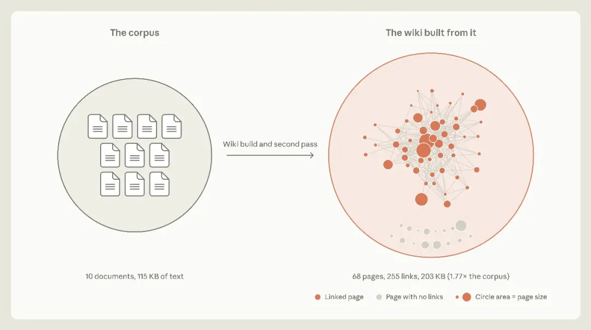

图 12：维基体积膨胀至原本语料 1.77 倍的反面案例结构图

---

## 七、记忆分层注入：把索引写进脑门，把细节留在后台

既然做梦可以生成高价值知识，能否把它们全部塞进下一次对话的开头？**答案是绝对不行。**

直接在 Prompt 里无脑注入上下文不仅消耗宝贵的 Token，更致命的是，错误的信息会污染后续每一次决策。官方使用说明指出：**过长的系统指令会导致模型遵守规则的能力明显滑坡。**

因此，记忆的最顶层必须极其克制。做梦的关键功能之一，是把枝节细节压回下层，顶层只保留跳转链接。

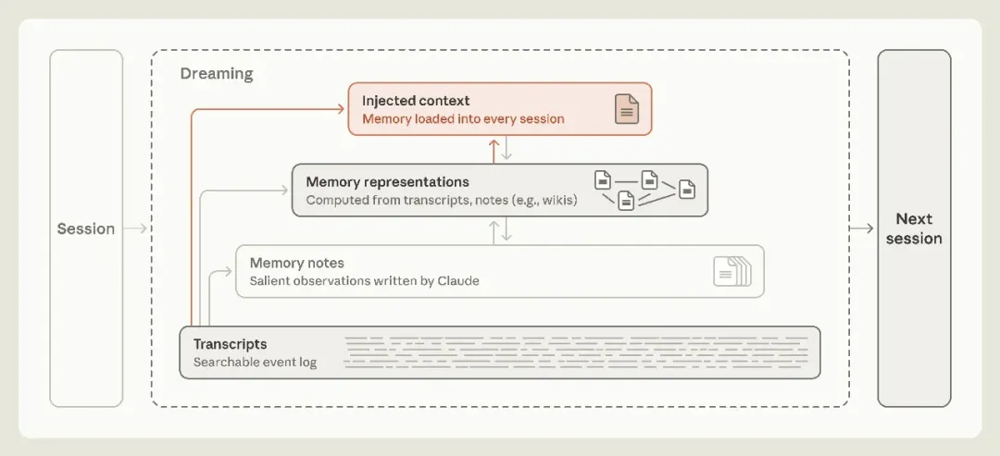

图 13：顶层注入上下文与下层被动检索层级的流动关系图

Claude Code 自带的自动记忆机制就采用了这种克制策略：
* 它不会把所有记忆塞入上下文窗口，**每次启动只读取 `MEMORY.md` 的前 200 行或前 25 KB 内容**；
* 这一小段文字充当全知索引，只告诉 Claude 自己懂什么、去哪里能调出这些信息。

---

## 八、做梦填补多智能体协作漏洞

在多智能体协同编写知识库时，“做梦”同样扮演着主编的角色。

在模拟法律合同文书的一项测试中，起初多个智能体同时把提取到的合同条款写进同一个名为 `provisions.md` 的文件表格里。结果多个 Agent 在保存文件时互相覆盖，导致 57 条核心事实只存活下来 41 条，关键事实丢失率高达 28%。

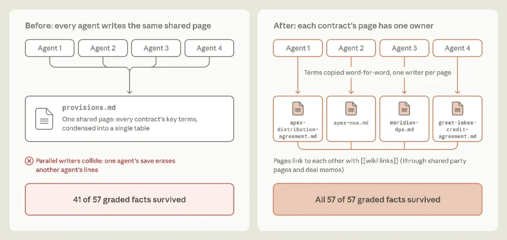

图 14：多个 Agent 覆盖写入导致信息丢失，与独立拆分单页逐字引用后的保留率对比图

系统随后开启做梦反思：Claude 复盘了这次丢失事故，自主重写了构建规则：**禁止多智能体共用一个文件，改为每个合同建立单页，且关键法律条款必须逐字摘录、禁止脑补摘要**。规则修正后，57 条核心条款全部留存，测试达标率从 72% 提升至 100%。

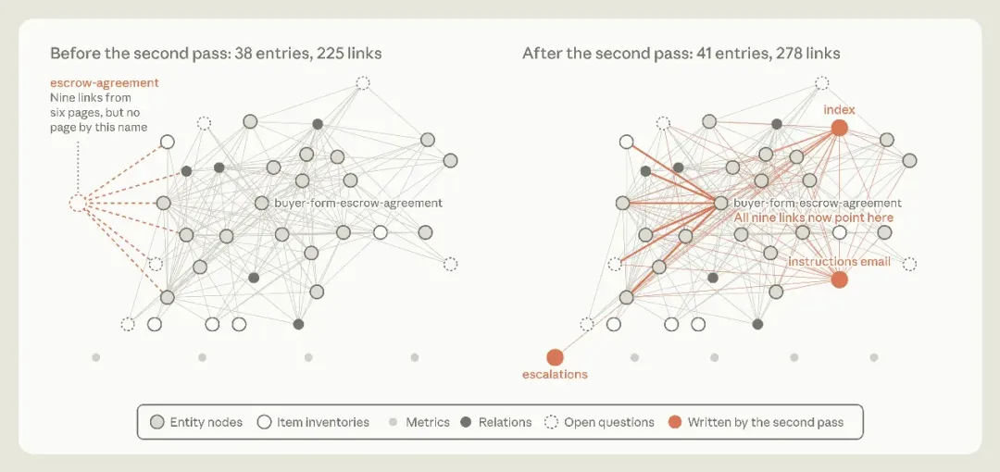

图 15：二次做梦修复失效超链接、补充目录与升级索引的前后网络对比图

**做梦还能自动修补死链**：在维基早期版本中，有 6 个页面同时引用了一个尚未建立的托管协议页面。通过第二轮离线做梦，Claude 自动扫描到了这 9 处死链，把它们全部重定向到了真实存在的对应文件上，顺手还补写了总目录与指令索引页。

---

## 九、实时记笔记，还是靠离线做梦？工程权衡与未来展望

智能体记忆系统仍然存在诸多关键的工程权衡：

1. **记笔记的时机问题**：如果在执行任务当下实时写记忆，确实能即刻保存第一现场的见解，但这会不可避免地分散模型做核心任务的注意力；如果全部留给离线做梦在后台做，主线任务不受打扰，做梦沉淀出来的智力资产却无法即时用于当前对话。
2. **记忆的维护开销**：外部世界在变，旧记忆会漂移失效。但如果让 Claude 时时刻刻去全面核对以往的全部记忆，算力开销将大到无法承受。

如何依据记忆被调用的频率来动态分配做梦的频次，将是未来设计智能体记忆的核心课题。

大模型无法百分之百准确预测未来的需要。但通过在任务间歇向后反思、离线做梦，AI 终于迈出了走出“金鱼记忆”、自主修正错误的关键一步。
